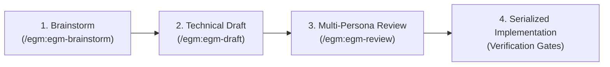

# Elephant-Goldfish: AI Agent Steering & Context Architecture (`AGENTS.md`)

This document is the central steering specification for AI coding agents (Antigravity, Claude Code, Cursor, Copilot) operating within the Elephant-Goldfish repository. It adopts the **Home Repo Pattern** to provide a single source of truth for architectural constraints, subsystem boundaries, pedagogical invariants, and agent workflows.

---

## 1. System Identity & Pedagogical Mission

**Elephant Goldfish** is an offline-first, tactile North Carolina Grade 2 mathematics web application built with React 19, TypeScript, Vite 8, Tailwind CSS v4, Radix UI, and the Looseleaf procedural ink rendering engine.

The application delivers concrete, manipulative-first learning across three foundational curriculum standards:

1. **`NC.2.OA.4`**: Rectangular Arrays (`[🍪 Arrays]`) — Grid-based spatial repeated addition ($5 \times 5$ max).
2. **`NC.2.OA.3`**: Odd and Even Parity (`[🌰 Odd & Even]`) — Buddy-pairing mat and 2-column grouping ($1$ to $20$).
3. **`NC.2.G.3`**: Geometry Partitioning Lab (`[📐 Geometry]`) — Equal partitioning of rectangles and circles into 2 halves, 3 thirds, and 4 fourths.

---

## 2. Inviolable Architectural Ground Rules

Every agent operating in this repository must strictly adhere to the following non-negotiable constraints:

### 1. Classroom Hardware Envelope

- **Target Platform**: Standard elementary school Chromebooks (4 GB RAM, dual-core Intel Celeron / ARM processors, 32 GB eMMC, ChromeOS LTS channels).
- **Hard Boundaries**:
  - **Zero Heavy Runtime Models**: Reject features requiring large on-device neural models (e.g., Gemini Nano) or high GPU fill-rate thrashing.
  - **Memory Limits**: All operations must maintain a resident memory footprint $< 120\text{ MB}$.
  - **Zero Layout Thrashing**: Animations and transitions must rely strictly on CSS compositor layers (opacity, transform) or scoped view transitions.

### 2. Pure Mathematical Ground Truth

- **Zero-Dependency Evaluators**: Pure math evaluators in `src/lib/math/` and curriculum seeds in `src/curriculum/` are strictly synchronous and decoupled from React, DOM, SVG, and browser globals.
- **Node 26 Invariant Execution**: Evaluators must run in pure Node 26 (`node --experimental-strip-types`) with zero DOM polyfills.
- **Invariant Test Gate (< 250 ms Budget)**: All 43 deterministic tests across 5 test suites (`tests/invariants/*.test.ts`) must maintain a 100% pass rate in $< 250\text{ ms}` total duration.

### 3. COPPA Compliance & Absolute Privacy

- **Zero External Network Telemetry**: The application must never make outbound HTTP/WebSocket network calls to external APIs, analytics collectors, or cloud LLMs.
- **Zero Persistent PII**: Never store student names, location data, or behavioral logs on disk or in remote databases.
- **Offline Reliability**: The entire curriculum must remain 100% functional without an active internet connection.

### 4. Coordinate Projection & Snapping Invariance

- **Locked Aspect Ratios**: Interactive SVG manipulatives (`BakingPan.tsx`, `TartPlate.tsx`) must maintain fixed coordinate dimensions (`viewBox="0 0 800 500"`, `aspect-[16/10]`) with `preserveAspectRatio="xMidYMid meet"`.
- **Snapping Threshold**: The Schmitt-trigger snapping engine ($\pm 5\%$ attraction, $\pm 10\%$ release) in `declarative-drag.ts` relies on stable matrix coordinate inversion via `svg.getScreenCTM()?.inverse()`. Never mutate SVG coordinate origins during active drag operations.

### 5. Looseleaf Procedural Ink Engine Invariants

- **Synchronous Render Pipeline**: Ink texture rendering in `src/lib/ink/react/cache.ts` executes synchronously inside React `useMemo` hooks. Never inject asynchronous yielding (`await scheduler.yield()`) into synchronous `inkFrame()` execution, as this fractures React rendering across all 120+ Looseleaf UI primitives.

### 6. UI Overlays & Focus Management

- **Radix UI Backbone**: Stationery dialogs, popovers, and tooltips (`src/components/ui/`) rely on Radix UI (`radix-ui` v1.8.1) for focus containment, keyboard roving, Esc dismissal, and screen-reader ARIA states. Do not layer competing CSS positioning engines over Radix without neutralizing Floating UI inline styles.

---

## 3. Subsystem Context Pointers & File Directory Map

Use these context pointers to navigate the codebase without scanning thousands of lines:

| Subsystem Domain                 | Primary Directory Paths                                     | Key Responsibilities & Invariants                                                                                                                |
| :------------------------------- | :---------------------------------------------------------- | :----------------------------------------------------------------------------------------------------------------------------------------------- |
| **Math Ground Truth**            | `src/lib/math/`<br>`src/curriculum/`<br>`tests/invariants/` | Pure mathematical diagnostic functions, item seeds, and Node 26 invariant test suites. Synchronous, zero-dependency.                             |
| **Looseleaf UI Engine**          | `src/lib/ink/`<br>`src/components/ui/`                      | 120+ tactile stationery UI primitives (Paper, Tape, Desk, Seal, Badge, Stamp) and procedural SVG ink texture cache.                              |
| **Classroom Shell & Wireframes** | `src/App.tsx`<br>`src/components/math/`                     | App shell, navigation standard switcher, tactile manipulative components (`BakingPan`, `TartPlate`, `SupplyTray`, `PairingMat`), and wireframes. |
| **State Machines & Scaffolding** | `src/lib/state/`<br>`src/hooks/`                            | Socratic scaffolding ladders, student profile storage, and audio narration coordination.                                                         |
| **Design Specifications**        | `docs/designs/`<br>`docs/designs/SITEMAP.md`                | Formal technical design documents and architectural decision records (ADRs).                                                                     |
| **EGM Review Archive**           | `docs/reviews/`                                             | Permanent repository of Goldfish review audit reports, zoom-out analyses, and readiness scorecards.                                              |

---

## 4. Elephant-Goldfish Model (EGM) Development Lifecycle

When planning, designing, or implementing features in this repository, follow the 4-phase EGM lifecycle:



1. **Phase 1: Brainstorming (`egm-brainstorm`)**:
   - Synthesize requirements across pedagogical, design, and technical lenses.
   - Archive initial concepts into `docs/reviews/<feature-name>/concepts_brief.md`.
2. **Phase 2: Formal Technical Design (`egm-draft`)**:
   - Author a complete engineering specification in `docs/designs/<feature-name>.md`.
   - Register the specification in `docs/designs/SITEMAP.md`.
3. **Phase 3: Multi-Persona Review Pipeline (`egm-review`)**:
   - Run the 9-stage review pipeline using specialized Goldfish subagent personas:
     - `egm-zoom-out` (Skeptical Architect): Audits simplicity, YAGNI, and anti-bloat.
     - `egm-comprehension` (Naive Reader): Audits terminology and cognitive gaps.
     - `egm-design` (Hostile Design Critic): Audits hardware viability and edge cases.
     - `egm-structural` (Document Architect): Audits layout symmetry and headings.
     - `egm-style` (Technical Copy Editor): Audits tone, precision, and eliminates fluff.
     - `egm-codebase-details` (Quality Auditor): Verifies physical codebase realities.
     - `egm-implementation-readiness` (Tech Lead): Verifies actionability and test commands.
   - Save consolidated reports into `docs/reviews/<feature-name>/`.
4. **Phase 4: Serialized Implementation**:
   - Implement in phased, serialized work packages with strict file partitioning to avoid git merge collisions.
   - Verify every gate before concluding.

---

## 5. Universal Verification Matrix

Execute these commands to verify codebase health:

```bash
# Gate 1: Pure Mathematical Invariant Matrix (< 250 ms budget)
# Runs all 43 deterministic tests across 5 suites in pure Node 26
npm test

# Gate 2: Static Lint & Code Quality Check
# Validates 0 errors under Oxlint across 380+ files
npm run lint

# Gate 3: TypeScript Type-Safety Check
# Asserts verbatimModuleSyntax and erasableSyntaxOnly without type errors
npm run typecheck

# Gate 4: Vitest Component & UI Harness
# Executes React Testing Library and HappyDOM UI component tests
npm run test:ui

# Gate 5: Production Bundle Compilation
# Confirms Vite 8 and TypeScript release build
npm run build

# Composite Release Gate
# Formats code with Prettier and runs all linters, security audits, tests, and build
npm run format && npm run check && npm run test:ui
```
