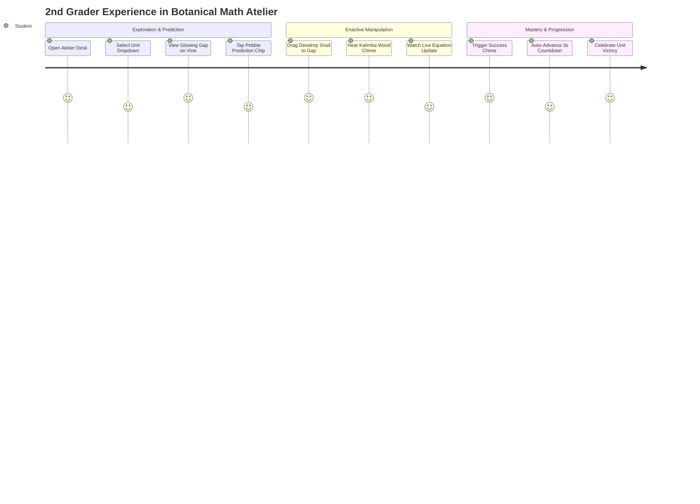

# Unified Hybrid Kids Learning Architecture: The Botanical Math Atelier

- **Author:** Technical Design Team & EGM Swarm
- **Status:** Finalizing (Interactive Demo Tested · Ready for Implementation)
- **Date:** 2026-11-16
- **Branch:** `feature/hybrid-kids-learning-experience`
- **Target Repository:** `https://github.com/asub927/egm-looseleaf-experiment`
- **Target Standards:** NC.2.OA.2, NC.2.OA.3, NC.2.OA.4, NC.2.G.3 (Aligned with Khan Academy Grade 2 Math Sequence)

---

## 1. Overview & Pedagogical Mission

This specification defines the unified design architecture for **The Botanical Math Atelier**, a tactile, offline-first mathematics learning desk engineered specifically for 2nd-grade students (ages 7–8).

By synthesizing the strongest empirical findings from early childhood cognitive research, our previous session logs, and five distinct design paradigms, this system replaces text-heavy instructional edtech with an enactive, low-cognitive-load laboratory:

```
┌─────────────────────────────────────────────────────────────────────────────┐
│                    THE BOTANICAL MATH ATELIER (HYBRID)                      │
├───────────────────────────────────┬─────────────────────────────────────────┤
│ 1. Navigation & Progression Shell │ blu.school Minimalist Unit Dropdown     │
│ 2. Spatial Direct Manipulation    │ Synthesis "Glowing Gap" + Magnetic Snap │
│ 3. Affective Tone & Delight       │ Whispering Vine Living Garden & Kalimba │
│ 4. Cognitive CPA Bridge           │ Prediction Chips + Dynamic Equation     │
│ 5. Technical Platform             │ Chrome Modern Web Guidance (PWA/Zero-Jank)│
└───────────────────────────────────┴─────────────────────────────────────────┘
```

The application operates 100% client-side with zero telemetry (COPPA exempt), maintains a resident memory footprint $< 120\text{ MB}$ on budget school Chromebooks, and executes all mathematical evaluations deterministically in $< 250\text{ ms}$ under Node 26.

---

## 2. The Problem

1. **The Reading & Decoding Trap in Early Elementary EdTech**:
   Second graders decode text at approximately 400L. Requiring a 7-year-old to read multi-sentence instructions before solving a math problem consumes working memory (approx. $3 \pm 1$ cognitive chunks) on literacy rather than spatial and quantitative reasoning.
2. **Abstract Equations Preceding Physical Intuition**:
   Traditional math apps present symbolic numerals ($14 - 6 = \text{?}$ or $3 \times 4 = 12$) before the child has physically experienced equal grouping, arrays, or decomposition. Under Bruner’s CPA theorem, understanding must progress from **Concrete (Enactive)** to **Pictorial (Iconic)** and finally **Abstract (Symbolic)**.
3. **Hyperactive Gamification & Sensory Fatigue**:
   Commercial math games often utilize high-frequency visual flashing, loud electronic buzzers on mistakes, and high-pressure timers that induce math anxiety and sensory overload, particularly for neurodiverse students.
4. **Layout Fragility on School Hardware**:
   School device carts feature low-resolution screens ($1366 \times 768$ Chromebooks and 10-inch tablets) with erratic touch digitizers. Desktop-first layouts induce accidental vertical scrolling, dropped inputs, and broken aspect ratios during active drag operations.

---

## 3. The 4-Layer Hybrid Solution

### Layer 1: Navigation & Progression Shell (`blu.school` Inspiration)

- **Minimalist Top Chrome**: Replaces cluttered tab bars with a clean, pill-shaped unit selector dropdown.
- **Khan Academy 4-Unit Mental Math Sequence**:
  - **Unit 1**: _Making Ten & Whispering Vine_ ($10 - ?$, complement decomposition).
  - **Unit 2**: _Spatial Arrays & Stamp Garden_ (Repeated addition, rows $\times$ cols, commutativity).
  - **Unit 3**: _Parity & Buddy Ponds_ (Odd and even pairing, equal addends $N = A + A$).
  - **Unit 4**: _Artisan Geometry Kitchen_ (Equal partitioning into halves, thirds, fourths).
- **Milestone Pip Progress**: Clean pip indicators (`● ● ○ ○ ○`) with unhurried 3-second auto-progression countdown and immediate skip option.
- **Sensory Calm Mode**: Dedicated toggle that eliminates pulsing glow animations and suppresses non-essential motion.

### Layer 2: Spatial Direct Manipulation (Synthesis "Glowing Gap" Paradigm)

- **Self-Explaining Interfaces**: Rather than text prompts, recipient targets (empty vine nodes, unfilled array matrix slots, buddy mat columns, cut lines) display a soft-pulsing gold/mint luminous aura (`.glowing-gap`).
- **Tactile Magnetic Snapping**: Pointer movements within $\pm 5\%$ attraction capture smoothly into integer basins with an audible wood-kalimba thud.
- **Dual-Input Contract**: Continuous pointer dragging is 100% paired with single-tap accessible selection for students on trackpads.

### Layer 3: Affective Tone, Metaphor & Sound (Whispering Vine & Kalimba)

- **Botanical Warmth**: Soft-cream desk (`#fbf9f5`), terracotta (`#d97757`), bamboo green (`#5c8d76`), and golden bloom (`#f59e0b`).
- **Web Audio Kalimba Synthesizer**: Replaces buzzer sounds with a dual-oscillator (sine + triangle) wooden marimba/kalimba scale across 10 pentatonic frequencies ($C_4$ to $C_6$). Each placed token sounds a harmonious note; completing a challenge triggers a 4-chord celebration chime.
- **Companion Mascots**: Low-pressure, curious guides (Barnaby the Snail, Kit the Fox, Baker Pip, Pencil Pal) who encourage rather than evaluate.

### Layer 4: The Cognitive CPA Bridge (Prediction Chips & Live Equation)

- **Enactive (Concrete)**: The child touches and drags physical items in the glowing gap.
- **Iconic (Pictorial)**: The spatial representation (bamboo stalk, cookie grid, pairing lane) updates visually.
- **Symbolic (Abstract)**: A live equation container builds itself dynamically below the canvas as items move ($7 + [3] = 10 \rightarrow 10 - 7 = 3$), permanently connecting the physical action to mathematical symbols.
- **Metacognitive Reflection**: A quick 2-second playful prediction ("Pebble Guess") before manipulation primes spatial estimation. If a child's prediction differs from their physical solution, the mascot offers a gentle mismatch reflection: _"Look at that! Your hands found the answer! You predicted 4, but it only took 3 to reach 10."_

---

## 4. Critical User Journeys (CUJs)



### CUJ 1: Unit 1 — Making Ten via Whispering Vine (NC.2.OA.2)

1. **Entry**: Student opens Unit 1. The vine displays 7 terracotta dewdrops. The golden flower at node 10 is dormant.
2. **Spatial Invitation**: Nodes 8, 9, and 10 pulse with a soft golden glow.
3. **Prediction**: Student taps pebble chip `[3]`.
4. **Action**: Student drags the dewdrop snail upward. Nodes 8, 9, 10 illuminate in emerald mint. The kalimba plays notes $E_5, G_5, C_6$.
5. **Symbolic Resolution**: Live equation confirms $7 + [3] = 10 \rightarrow 10 - 7 = 3$. Golden blossom blooms.
6. **Auto-Advance**: 3-second countdown automatically moves to Question 2.

### CUJ 2: Unit 2 — Repeated Addition via Stamp Garden (NC.2.OA.4)

1. **Entry**: Grid presents $3 \times 4$ empty matrix.
2. **Spatial Invitation**: Empty cookie slots glow with subtle amber rings.
3. **Action**: Student taps or drags cookies into the rows. Each row of 4 sounds a full wooden marimba chord.
4. **Symbolic Resolution**: Live equation displays $4 + 4 + 4 = 12$, reinforcing row-based repeated addition.

### CUJ 3: Unit 3 — Parity & Buddy Ponds (NC.2.OA.3)

1. **Entry**: Mat presents 7 acorns.
2. **Action**: Acorns snap into two equal vertical columns. 3 pairs lock together with harmonious pair tones; 1 acorn remains alone on the right.
3. **Symbolic Resolution**: Equation displays $3 + 3 + 1 = 7 \text{ (Odd Number!)}$.

### CUJ 4: Unit 4 — Geometry Equal Shares (NC.2.G.3)

1. **Entry**: Rectangular pan or circular tart is presented.
2. **Action**: Student pulls the magnetic cutter handle. Cutter snaps into $\frac{1}{3}$ division lines with magnetic haptic snap.
3. **Symbolic Resolution**: Equation displays $1 \text{ whole} = 3 \text{ equal thirds}$.

---

## 5. Technical Architecture & React Component Hierarchy

```
App.tsx (Atelier Stage Shell)
 │
 ├── AtelierHeader (blu.school Navigation)
 │    ├── BrandTitle ("Botanical Math Atelier")
 │    ├── UnitDropdownMenu (Units 1-4 Selector)
 │    ├── AudioToggle (Web Audio Kalimba Bus)
 │    └── CalmModeToggle (Reduced Motion / Low-Stimulation)
 │
 ├── ProgressBar (Pip Progress & Auto-Advance Banner)
 │
 ├── AtelierStage (Responsive @container Desk Canvas)
 │    │
 │    ├── [Unit 1]: WhisperingVine.tsx
 │    │    ├── SVG Bamboo Vine & Terracotta Pot
 │    │    ├── GlowingGapNodes (Pulsing SVG targets)
 │    │    └── DewdropSnail (Declarative Pointer Handle)
 │    │
 │    ├── [Unit 2]: ArrayBoard.tsx (Stamp Garden)
 │    │    ├── GlowingMatrixSlots
 │    │    └── CookieStampTray
 │    │
 │    ├── [Unit 3]: PairingMat.tsx (Buddy Ponds)
 │    │    ├── DualColumnMat
 │    │    └── AcornTokens & Orphan Slot
 │    │
 │    └── [Unit 4]: BakingPan.tsx / TartPlate.tsx (Artisan Kitchen)
 │         ├── SVG Pan / Plate (Locked 16:10 Aspect Ratio)
 │         └── DeclarativePartitionCutter
 │
 └── PedagogicalSidebar
      ├── MascotCompanion.tsx (Pencil Pal / Dewdrop Snail)
      ├── PebblePredictionChips.tsx ("First: What do you think?")
      ├── DynamicEquationBridge.tsx (CPA Symbolic Formulation)
      └── GrownUpCoPlayCard.tsx
```

---

## 6. State Machine Integration

All state transitions are governed by deterministic finite state machines in `src/lib/state/`:

1. **`vine-machine.ts`**: Manages dragging, snapping, prediction selection, mismatch reflection, and celebration states.
2. **`drag-machine.ts`**: Coordinates declarative pointer dragging, magnetic basin capture ($\pm 5\%$), and resting state transitions.
3. **`scaffolding-machine.ts`**: Implements the 3-tier Socratic ladder without negative buzzer penalties.
4. **`audio-narration-machine.ts`**: Controls real-time spoken subtitle synchronization and mascot pose transitions.

---

## 7. Verification Matrix & Release Gates

All code implementing this design must strictly satisfy the universal repository gates:

```bash
# Gate 1: Pure Mathematical Invariant Matrix (< 250 ms)
npm test

# Gate 2: Static Lint Quality (0 errors under Oxlint across 380+ files)
npm run lint

# Gate 3: TypeScript Verbatim Type-Safety
npm run typecheck

# Gate 4: Production Compilation (Vite 8 release build)
npm run build

# Composite Verification Gate
npm run check
```
