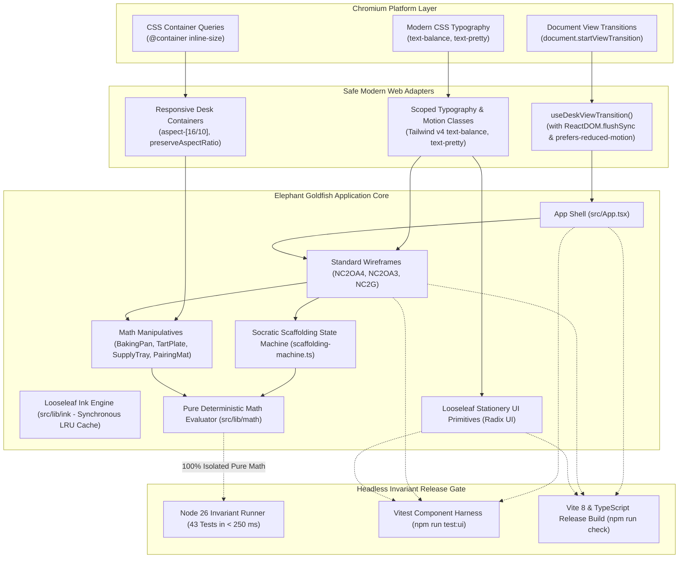

# Modern Web Guidance Modernization: Production Specification

- **Author:** Elephant-Goldfish Architecture Swarm & Technical Design Team
- **Status:** Approved / Ready for Implementation
- **Date:** 2026-11-15
- **Target Repository:** `https://github.com/asub927/egm-looseleaf-experiment.git`
- **Target Platform:** Chromium-based browsers on elementary classroom Chromebooks (4 GB RAM, dual-core Intel Celeron / ARM processors, ChromeOS LTS channels)

---

## Overview

Elephant Goldfish is an offline-first, tactile North Carolina Grade 2 mathematics web application built with React 19, TypeScript, Vite, Tailwind CSS v4, Radix UI, and the Looseleaf procedural ink rendering engine. The application provides concrete, manipulative-first learning across three foundational curriculum standards:

1. **`NC.2.OA.4`**: Rectangular Arrays (`[🍪 Arrays]`)
2. **`NC.2.OA.3`**: Odd and Even Parity (`[🌰 Odd & Even]`)
3. **`NC.2.G.3`**: Geometry Partitioning Lab (`[📐 Geometry]`)

This technical design specifies the progressive modernization of Elephant Goldfish to Google Chrome's **Modern Web Guidance** standards. Following a rigorous 9-stage architectural review across 6 specialized review personas, the modernization focuses strictly on the **3 high-value, declarative platform tracks** that deliver 95% of student and classroom value with zero runtime risk:

- **Track 1: Same-Document View Transitions** for seamless standard navigation in `src/App.tsx`.
- **Track 2: CSS Container Queries** for responsive manipulative scaling across varied classroom screens in `BakingPan.tsx`, `TartPlate.tsx`, `SupplyTray.tsx`, and `PairingMat.tsx`.
- **Track 3: Modern Typography & CSS Motion** (`text-balance`, `text-pretty`, `interpolate-size`) for early-grade readability and layout stability in `NC2OA4Wireframe.tsx`, `NC2OA3Wireframe.tsx`, `NC2GWireframe.tsx`, `MascotCompanion.tsx`, and `src/index.css`.

Speculative runtime subsystems evaluated during initial design (the on-device Prompt API, CSS Anchor Positioning layered over Radix UI, and task yielding shims in synchronous React rendering) have been evaluated and deliberately pruned into [Alternatives Considered & Pruned Approaches](#alternatives-considered--pruned-approaches) to eliminate out-of-memory crashes, test suite pollution, and concurrency hazards.

The implementation is governed by non-negotiable architectural constraints: **100% client-side privacy, zero telemetry, full COPPA compliance, deterministic mathematical ground truth, and a 100% pass rate across all 43 pedagogical invariant tests across 5 test suites (`curriculum`, `nc2-g`, `nc2-oa3`, `nc2-oa4`, and `vine_evaluator`) in pure Node 26 in $< 250\text{ ms}$.**

---

## The Problem

### 1. Spatial Disorientation from Abrupt Component Remounting (Track 1)

In the current application shell (`src/App.tsx`), switching between curriculum standards unmounts the active standard wireframe and mounts the target wireframe in a single render tick. For second-grade students (ages 7–8), this abrupt visual shift breaks spatial continuity. Students lose visual track of the tactile desk surface, toolbars, and companion mascot, increasing cognitive friction when moving between connected math concepts (e.g., transitioning from rectangular arrays to rectangular equal partitioning).

### 2. Viewport-Bound Breakpoints in Varied Classroom Displays (Track 2)

Elementary classroom Chromebooks feature diverse screen form factors, ranging from 11.6-inch displays ($1366 \times 768$) to high-DPI tablets and split-window arrangements. The current math manipulatives (`BakingPan`, `TartPlate`, `PairingMat`, `SupplyTray`) rely on viewport-level media queries or fixed dimensions. When teachers open side-by-side accessibility panels or students use window splitting, manipulative trays clip, overflow, or distort, making drag targets difficult to interact with on trackpads.

### 3. Early-Literacy Typographic Deficiencies and Subtitle Layout Shifts (Track 3)

Early-grade readers struggle with jagged line wraps and orphan words (single words isolated on the final line of a problem prompt or dialogue bubble). Furthermore, as the companion mascot (**Kit**) speaks instructional prompts, dynamically updating text without explicit container bounds causes cumulative layout shifts (CLS), bumping interactive manipulative canvases down during active drag or placement gestures.

---

## Proposed Solution

A focused, 3-track declarative modernization program delivered through progressive enhancement:

1. **Same-Document View Transitions (Track 1)**: Wrap top-level standard switching in `src/App.tsx` with a dedicated `useDeskViewTransition` hook using `document.startViewTransition` and `ReactDOM.flushSync`, creating smooth paper-slide cross-fades that preserve desk spatial continuity.
2. **Container Query Scaling (Track 2)**: Apply `@container (inline-size)` to manipulative workspace containers while strictly preserving internal SVG aspect ratios (`aspect-[16/10]` for `BakingPan` and `TartPlate`), ensuring tactile manipulatives scale fluidly to any container width without coordinate drift or breaking pointer snapping.
3. **Typographic Balance & Layout Stabilization (Track 3)**: Add `text-wrap: balance` to static section titles and standard prompt headers, and `text-wrap: pretty` with bounded container heights to Kit's dialogue cards, eliminating orphan words without layout thrashing.

---

## Goals

- **Goal 1 (Spatial Navigation Continuity)**: Provide smooth, hardware-accelerated transitions between curriculum standards in `src/App.tsx`, respecting `prefers-reduced-motion` and avoiding DOM snapshotting race conditions.
- **Goal 2 (Responsive Desk Containers)**: Allow `BakingPan`, `TartPlate`, `SupplyTray`, and `PairingMat` to adapt fluidly to container widths from $320\text{ px}$ to $1200\text{ px}$ without distorting SVG coordinate projection matrices or breaking the Schmitt-trigger pointer snapping engine.
- **Goal 3 (Enhanced Early-Literacy Readability & Zero CLS)**: Prevent orphan words in Grade 2 problem descriptions and companion dialogues through native CSS text-wrapping algorithms without cumulative layout shifts or dropped audio frames.
- **Goal 4 (Pedagogical Invariant Test Integrity)**: Maintain a 100% pass rate across all 43 deterministic pedagogical invariant tests (`tests/invariants/*.test.ts`) running under pure Node 26 in $< 250\text{ ms}$.
- **Goal 5 (Classroom Hardware Reliability)**: Guarantee zero white-screen crashes, zero memory leaks, and zero blocking error modals on 4 GB RAM Intel Celeron and ARM Chromebooks running ChromeOS LTS channels.
- **Goal 6 (Pure Client-Side Privacy)**: Zero network telemetry, zero third-party dependencies, and 100% offline COPPA compliance.

---

## Non-Goals

- **No Speculative On-Device or Cloud AI**: No generative LLM bridges (`window.ai`, Gemini Nano, cloud APIs) will be deployed. The deterministic 3-tier scaffolding engine in `src/hooks/use-geometry-scaffolding.ts` remains the sole pedagogical hint system.
- **No Replacement or Hacking of Radix UI Overlays**: Radix UI primitives in `popover.tsx` and `tooltip.tsx` will not be altered with experimental CSS Anchor Positioning rules that collide with Floating UI inline transforms.
- **No Asynchronous Task Yielding in Synchronous React Pipelines**: No `scheduler.yield()` or microtask shims will be injected into `src/lib/ink/react/cache.ts` where rendering is synchronous within React `useMemo`.
- **No Mutation of SVG Aspect Ratios During Pointer Drag**: Internal SVG `viewBox` coordinates (`0 0 800 500`) and aspect ratios will remain immutable during pointer capture.
- **No Micro-Transitions on Manipulative Tokens**: Individual cookie counters, chestnuts, and fraction dividers will not carry unique `view-transition-name` attributes to avoid GPU fill-rate thrashing on Intel Celeron GPUs.

---

## Technical Plan & Architecture

The architecture organizes the 3 Modern Web Guidance tracks into clean, declarative layers verified against existing browser baselines and test runners.



---

### Detailed Architecture by Track

#### Track 1: Navigation Architecture (Same-Document View Transitions)

- **Module**: `src/lib/dom/view-transitions.ts` & `src/App.tsx`
- **Execution Mechanism**:
  1. Standard navigation in `src/App.tsx` invokes `useDeskViewTransition()`, which returns a transition execution wrapper `(updateFn: () => void) => void`.
  2. The hook verifies `document.startViewTransition` availability and checks `window.matchMedia('(prefers-reduced-motion: reduce)').matches`. If reduced motion is requested or the API is absent, `updateFn()` executes immediately and synchronously.
  3. When supported, `document.startViewTransition` executes with `ReactDOM.flushSync(() => updateFn())`, ensuring React 19 commits the new standard wireframe DOM synchronously before the browser captures the destination snapshot.
  4. An internal boolean ref (`isTransitioningRef`) locks incoming transitions, ignoring duplicate tab clicks until the active transition promise settles.
  5. Scoped `view-transition-name` rules (`desk-stage`, `desk-toolbar`) are declared in `src/index.css`. Manipulative tokens (counters, dividers) are strictly excluded from transition names to eliminate GPU fill-rate thrashing on Intel Celeron GPUs.

#### Track 2: Fluid Desk & Manipulative Layout (CSS Container Queries)

- **Modules**: `src/components/math/NC2GWireframe.tsx`, `NC2OA4Wireframe.tsx`, `NC2OA3Wireframe.tsx`, `BakingPan.tsx`, `TartPlate.tsx`, `SupplyTray.tsx`, and `PairingMat.tsx`
- **Execution Mechanism**:
  1. The outer workspace container wrapping each manipulative desk receives `@container (inline-size)` and `container-type: inline-size`.
  2. To prevent coordinate drift in the declarative pointer snapping engine (`declarative-drag.ts`), inner interactive SVGs retain fixed, immutable `viewBox` coordinates (`viewBox="0 0 800 500"` with `CENTER_X = 400`, `CENTER_Y = 250` for both `BakingPan` and `TartPlate`) and fixed aspect ratio utility classes (`aspect-[16/10]`) with `preserveAspectRatio="xMidYMid meet"`.
  3. Responsive sizing operates exclusively on outer card padding, tool badge layouts, and supply tray grids using Tailwind v4 container query classes (`@sm:p-4`, `@md:gap-4`).
  4. In `PairingMat.tsx`, the 3-column buddy pairing layout (`grid-cols-[60px_1fr_1fr]`) is strictly preserved; container query classes adapt slot dimensions and padding. In `SupplyTray.tsx`, container queries dynamically scale token chips.
  5. In `declarative-drag.ts`, the coordinate projection function (`getSvgPoint`) continues to convert `(clientX, clientY)` to SVG coordinate space via `svg.getScreenCTM()?.inverse()`. Because the SVG aspect ratio is physically locked, coordinate projections and the Schmitt-trigger snapping threshold ($\pm 5\%$ attraction, $\pm 10\%$ release) remain mathematically invariant across all container widths.

#### Track 3: Modern Typography & CSS Motion

- **Modules**: `src/components/math/NC2OA4Wireframe.tsx`, `NC2OA3Wireframe.tsx`, `NC2GWireframe.tsx`, `MascotCompanion.tsx`, and `src/index.css`
- **Execution Mechanism**:
  1. Static problem titles, standard badge descriptions, and primary instruction headers receive `text-wrap: balance` via Tailwind's `text-balance` class. Balanced line breaks distribute character counts evenly, preventing single-word orphan lines on wide screens.
  2. Spoken narrative dialogues in `MascotCompanion.tsx` receive `text-wrap: pretty` via Tailwind's `text-pretty` class. Unlike `balance`, `pretty` executes a fast greedy line-breaking pass with orphan avoidance, eliminating layout thrashing during word-by-word subtitle highlighting.
  3. In `src/index.css`, `@supports (interpolate-size: allow-keywords)` enables smooth CSS height transitions to `height: auto` on hint panels and drawers. Dialogue containers in `MascotCompanion.tsx` define explicit `min-h-[80px]` styles to ensure expanding text never cascades layout shifts into the interactive manipulative canvas below.

---

## Detailed Implementation Plan

The implementation is structured into two sequential stages with explicit file touchpoints, verification commands, and runtime fallback contracts.

### Complete File Touchpoint Registry

| File Path                                       |   Action   |     Track      | Modification Rationale                                                                                                                                                                    |
| :---------------------------------------------- | :--------: | :------------: | :---------------------------------------------------------------------------------------------------------------------------------------------------------------------------------------- |
| `src/lib/dom/view-transitions.ts`               | **Create** |    Track 1     | Exports `useDeskViewTransition()` hook wrapping state transitions in `document.startViewTransition` with `ReactDOM.flushSync`, concurrency lock ref, and `prefers-reduced-motion` bypass. |
| `src/App.tsx`                                   | **Modify** |    Track 1     | Wraps curriculum standard switcher handlers (`setActiveStandard`) in `useDeskViewTransition` and attaches `.desk-stage` transition class.                                                 |
| `src/index.css`                                 | **Modify** |  Tracks 1, 3   | Declares scoped `view-transition-name: desk-stage` and `view-transition-name: desk-toolbar` rules; enables `@supports (interpolate-size: allow-keywords)`.                                |
| `src/components/math/NC2OA4Wireframe.tsx`       | **Modify** |  Tracks 1, 3   | Adds `.desk-toolbar` to navigation header and applies `text-balance` to primary standard instruction header.                                                                              |
| `src/components/math/NC2OA3Wireframe.tsx`       | **Modify** |  Tracks 1, 3   | Adds `.desk-toolbar` to navigation header and applies `text-balance` to primary standard instruction header.                                                                              |
| `src/components/math/NC2GWireframe.tsx`         | **Modify** | Tracks 1, 2, 3 | Adds `.desk-toolbar` to navigation header, applies `@container` to manipulative workspace wrapper, and applies `text-balance` to headers.                                                 |
| `src/components/math/BakingPan.tsx`             | **Modify** |    Track 2     | Enforces `aspect-[16/10]` and `viewBox="0 0 800 500"` with `preserveAspectRatio="xMidYMid meet"` for coordinate projection stability.                                                     |
| `src/components/math/TartPlate.tsx`             | **Modify** |    Track 2     | Enforces `aspect-[16/10]` and `viewBox="0 0 800 500"` with `CENTER_X = 400`, `CENTER_Y = 250` for coordinate projection stability.                                                        |
| `src/components/math/SupplyTray.tsx`            | **Modify** |    Track 2     | Applies container query responsive classes (`@sm:gap-2`, `@md:gap-3`) to token chips.                                                                                                     |
| `src/components/math/PairingMat.tsx`            | **Modify** |    Track 2     | Applies container query responsive padding and slot sizing while preserving 3-column buddy pairing layout (`grid-cols-[60px_1fr_1fr]`).                                                   |
| `src/components/math/MascotCompanion.tsx`       | **Modify** |    Track 3     | Applies `text-pretty` and fixed `min-h-[80px]` container bounding to prevent cumulative layout shift on active manipulatives.                                                             |
| `tests/invariants/curriculum.invariant.test.ts` | **Verify** |     Safety     | Verified to maintain 100% pass rate in pure Node 26 without DOM imports.                                                                                                                  |
| `tests/invariants/nc2-g.invariant.test.ts`      | **Verify** |     Safety     | Verified to maintain 100% pass rate across all 10 geometric partition invariants in $< 50\text{ ms}$.                                                                                     |
| `README.md`                                     | **Modify** |      Docs      | Documents Modern Web Guidance enhancements, browser support baselines, and verification commands.                                                                                         |

---

### Work Package Sequencing & Phased Execution

#### Stage 1: Responsive Manipulatives & Typography (Tracks 2 & 3)

1. **Container Queries in Manipulative Workspaces**:
   - In `NC2GWireframe.tsx`, apply `@container (inline-size)` to the tactile geometry manipulative canvas wrapper.
   - In `BakingPan.tsx`, lock SVG `viewBox="0 0 800 500"` and apply `aspect-[16/10]` with `preserveAspectRatio="xMidYMid meet"`.
   - In `TartPlate.tsx`, lock SVG `viewBox="0 0 800 500"` (preserving `CENTER_X = 400`, `CENTER_Y = 250`) and apply `aspect-[16/10]`.
   - In `SupplyTray.tsx`, apply container query responsive utilities (`@sm:gap-2`, `@md:gap-3`) for token chip scaling.
   - In `PairingMat.tsx`, preserve the 3-column `grid-cols-[60px_1fr_1fr]` layout while applying container query padding.
2. **Typography Enhancements & Layout Shift Prevention**:
   - In `NC2OA4Wireframe.tsx`, `NC2OA3Wireframe.tsx`, and `NC2GWireframe.tsx`, add `text-balance` to primary prompt instruction headers.
   - In `MascotCompanion.tsx`, apply `text-pretty` and explicit `min-h-[80px]` bounding to speech bubble containers.
   - In `src/index.css`, enable `@supports (interpolate-size: allow-keywords)` on `:root`.
3. **Verification Command**:
   ```bash
   npm run format && npm run check && npm run test:ui
   ```

#### Stage 2: Spatial Navigation Transitions (Track 1)

1. **Same-Document View Transitions**:
   - Create `src/lib/dom/view-transitions.ts` exporting `useDeskViewTransition` with `ReactDOM.flushSync`, concurrency lock ref, and `prefers-reduced-motion` detection.
   - Update `src/App.tsx` to route `setActiveStandard` updates through `useDeskViewTransition` and assign the `.desk-stage` class to the main workbench area.
   - In `NC2OA4Wireframe.tsx`, `NC2OA3Wireframe.tsx`, and `NC2GWireframe.tsx`, attach `.desk-toolbar` to the navigation header.
   - In `src/index.css`, declare `view-transition-name: desk-stage` on `.desk-stage` and `view-transition-name: desk-toolbar` on `.desk-toolbar`.
2. **Final Verification Command**:
   ```bash
   npm run format && npm run check && npm run test:ui
   ```

---

## Verification Gates & Release Criteria

The implementation must satisfy five verification gates:

```bash
# Gate 1: Mathematical Invariant Matrix (< 250 ms budget)
# Runs all 43 deterministic tests in pure Node 26 without DOM overhead
npm test

# Gate 2: Static Lint & Code Quality Check
# Validates 0 errors and 0 warnings under Oxlint
npm run lint

# Gate 3: TypeScript Type-Safety Check
# Asserts verbatimModuleSyntax and erasableSyntaxOnly without type errors
npm run typecheck

# Gate 4: Production Bundle Compilation
# Confirms Vite 8 production build without asset warnings
npm run build

# Gate 5: Composite Release Gate
# Aggregates Prettier formatting, Oxlint, security checks, 43 invariant tests, production build, and Vitest UI tests
npm run format && npm run check && npm run test:ui
```

---

## Runtime Kill-Switch & Fallback Contracts

1. **Track 1 (View Transitions)**: If `!('startViewTransition' in document)` or `window.matchMedia('(prefers-reduced-motion: reduce)').matches`, bypass transitions entirely and call `updateFn()` synchronously.
2. **Track 2 (Container Queries)**: If the browser does not support CSS Container Queries, layout gracefully falls back to existing desktop flex/grid styles with fixed SVG `aspect-[16/10]` bounds.
3. **Track 3 (Typography & Motion)**: If `text-wrap: balance` or `text-wrap: pretty` is unsupported, the browser applies standard line wrapping with zero functional impact on curriculum evaluation.

---

## Alternatives Considered & Pruned Approaches

During architectural review across 6 specialized review personas, multiple proposed approaches were evaluated and deliberately pruned to eliminate technical risk, test harness bloat, and classroom hardware failures:

| Decision Area                         | Selected Approach                                                                                                  | Rejected Alternative                                                     | Explicit Architectural Rationale for Rejection                                                                                                                                                                                                                                                                                                                                                                                                                                                        |
| :------------------------------------ | :----------------------------------------------------------------------------------------------------------------- | :----------------------------------------------------------------------- | :---------------------------------------------------------------------------------------------------------------------------------------------------------------------------------------------------------------------------------------------------------------------------------------------------------------------------------------------------------------------------------------------------------------------------------------------------------------------------------------------------- |
| **Socratic Tutoring Engine**          | Retain deterministic 3-tier hint ladder in `useGeometryScaffolding.ts`; add static bilingual strings if ELL needed | On-device Prompt API (`window.ai` / Gemini Nano)                         | **Pruned (Stage 8 Blocker)**. Elementary classroom hardware (4 GB RAM, dual-core Intel Celeron / ARM Chromebooks on ChromeOS LTS) cannot allocate or execute local LLM models. The model download consumes 40+ GB concurrent classroom bandwidth. Inference times (> 1,500 ms) violate the 800 ms timeout, triggering fallbacks 100% of the time. LLM output risks leaking fraction numerals, violating NC.2.G.3 math standards. Deterministic hints are 100% reliable, instant, and COPPA compliant. |
| **Overlay Positioning Architecture**  | Retain `@radix-ui` primitives as-is with Floating UI positioning                                                   | CSS Anchor Positioning (`position-anchor`) layered over Radix UI         | **Pruned (Stage 7 & 9 Blocker)**. Radix UI mounts Floating UI, which writes inline `transform: translate3d(...)` styles directly to the DOM, conflicting with CSS Anchor Positioning compositor rules. Furthermore, Elephant Goldfish displays at most 1 active popover/tooltip at a time, making Anchor Positioning an unneeded optimization that pollutes `tests/setup.ts` with mock shims.                                                                                                         |
| **Main-Thread Scheduling**            | Purely synchronous Looseleaf ink caching in `src/lib/ink/react/cache.ts`                                           | Time-slicing procedural ink pre-warming with `scheduler.yield()`         | **Pruned (Stage 7 & 9 Blocker)**. Ink generation in `cache.ts` is purely synchronous within React `useMemo` hooks. No background pre-warming loop exists in the codebase. Inserting `await yieldToMain()` would require migrating all 120+ UI primitives to React Suspense, destabilizing the entire UI. Dragging manipulatives updates SVG transforms directly without recomputing ink, maintaining 60 FPS without scheduling shims.                                                                 |
| **Multi-Agent Coordination Model**    | Phased, serialized execution with strict file partitioning                                                         | Uncoordinated concurrent multi-agent swarm editing shared files          | **Rejected (Option B)**. Concurrent edits to `src/App.tsx`, `src/index.css`, and wireframes cause severe git merge collisions, duplicate Tailwind imports, and build failures. Serialized, file-partitioned execution guarantees clean integration.                                                                                                                                                                                                                                                   |
| **Manipulative Coordinate Stability** | Fixed `viewBox="0 0 800 500"` with locked `aspect-[16/10]`                                                         | Mutating SVG `viewBox` coordinates dynamically during container resizing | **Rejected**. Changing SVG coordinate space or center origins during active pointer interactions invalidates `svg.getScreenCTM()`, causing pointer coordinate drift and breaking the Schmitt-trigger snapping threshold ($\pm 5\%$ enter, $\pm 10\%$ release).                                                                                                                                                                                                                                        |
| **Typographic Wrapping Scope**        | `text-wrap: balance` on static titles; `text-wrap: pretty` on spoken dialogue                                      | `text-wrap: balance` on dynamic speech bubbles                           | **Rejected**. `text-wrap: balance` executes an iterative search algorithm. Recalculating balanced breaks during word-by-word subtitle highlighting causes CPU layout thrashing and dropped audio frames on budget Chromebooks.                                                                                                                                                                                                                                                                        |
