# NC.2.G Geometry Lab: Equal Partitioning via Tactile Declarative Snapping

- **Author:** Technical Design Team & EGM Ideation Swarm
- **Status:** Approved (Drafting Complete)
- **Date:** 2026-11-04
- **Target Repository:** `https://github.com/asub927/egm-looseleaf-experiment.git`

---

## Overview

This project introduces the **North Carolina Grade 2 Geometry curriculum (NC.2.G.3: Partitioning Circles and Rectangles)** into the Elephant-Goldfish offline tactile math desk. It teaches foundational spatial partitioning and early fraction readiness to 7- and 8-year-old students through physical, direct-manipulation gestures:

- **Rectangular Pan Partitioning (NC.2.G.3)**: Dividing a rectangular baking sheet or brownie pan into two, three, or four equal shares (_halves, thirds, fourths_).
- **Circular Tart Partitioning (NC.2.G.3)**: Dividing a circular fruit tart or personal pizza into two, three, or four equal shares (_halves, thirds, fourths_).

Rather than pulling in heavy third-party drag-and-drop frameworks (such as the research package `dragology`, which targets React 18/17 and bundles Immer and five separate D3 packages), the module introduces an internal, zero-dependency **declarative pointer snapping engine** (`src/lib/drag/declarative-drag.ts`). Built on native browser `PointerEvents`, `requestAnimationFrame`, coordinate projections, and Schmitt-trigger magnetic basins, it delivers high-fidelity tactile snapping with 0 external dependencies.

The module is integrated directly with the project's existing Looseleaf UI stationery design system (`@/components/ui`, `@/lib/ink`), companion mascot **Pencil Pal** (`MascotCompanion`), dual-bus audio synthesis (`src/lib/audio/audio-bus.ts`), and local client-only student profiles (`src/lib/storage/profile.ts`). It operates 100% offline with zero telemetry, preserving full Children's Online Privacy Protection Act (COPPA) exemption.

---

## The Problem

1. **Premature Symbolic Fraction Notation in Early Primary Grades**:
   Many elementary learning apps present second graders with abstract fraction bar notation ($\frac{1}{2}, \frac{1}{3}, \frac{1}{4}$). Under the North Carolina Standard Course of Study and Common Core, symbolic fraction numerals are not introduced until Grade 3 (NC.3.NF.1). For 7-year-olds, abstract fractional numerals create cognitive barriers that distract from spatial and verbal concepts: _two halves, three thirds, four fourths, half of, a third of, a fourth of_.
2. **Fine-Motor Friction on Classroom Trackpads**:
   Budget school Chromebooks and shared tablets feature low-precision trackpads and erratic touch digitizers. Requiring young children to continuously drag handles or coordinate multiple independent cut lines leads to dropped inputs, motor frustration, and accidental misalignment.
3. **Abstract Geometry Without Array Foundations**:
   Standard geometry curricula often treat shape partitioning in isolation from multiplication. In NC Grade 2, partitioning rectangles into equal rows and columns is the direct bridge to rectangular array multiplication (NC.2.OA.4) and Grade 3 area models. Without tactile, concrete connection between rectangular slices and repeated addition, children fail to build conceptual continuity.
4. **Heavy Dependency Overhead in Offline PWAs**:
   External drag libraries often bundle large graph math suites, state proxies, and incompatible React peer dependencies. In an offline-first PWA operating under sub-150ms pre-commit test constraints, third-party libraries introduce bundle bloat, React 19 reconciliation lag, and maintenance risk.

---

## Proposed Solution

A concrete, manipulative-first geometry laboratory where shapes are partitioned through tactile direct manipulation backed by single-tap accessible fallbacks:

- **Tactile Pan & Tart Manipulatives**: Food and stationery metaphors (brownie baking pans on graph paper, fruit tarts on wooden cutting boards) make partitioning intuitive and relatable.
- **Declarative Pointer Snapping**: Moving a cutter handle near equal fractional divisions ($50\%, 33.3\%, 25\%$) or radial spoke angles ($180^\circ, 120^\circ, 90^\circ$) triggers smooth magnetic capture with an audible tactile thud.
- **Dual-Mode Input Contract**: Continuous dragging is fully paired with prominent single-tap cutter badges (`[2 Halves ◫]`, `[3 Thirds ▥]`, `[4 Fourths ⊞]`) to ensure students on laptop trackpads or with motor difficulties succeed independently.
- **Verbal & Spatial Feedback**: Mathematical badges and audio narration use verbal shares (_"1 third"_, _"3 thirds make 1 whole pan"_), completely avoiding abstract fraction bars.
- **Socratic Scaffolding & Companion Audio**: Pencil Pal (`MascotCompanion`) narrates instructions and feedback via `useAudioNarration`, highlighting spoken subtitles in real time and providing a 3-tier hint ladder (Verbal Prompt $\rightarrow$ Ghost Visual Guides $\rightarrow$ Demonstrative Snap with Isomorphic Retry).
- **Headless Invariant Verification**: Pure math evaluation in `src/lib/math/geometry-evaluator.ts` ensures mathematical correctness and orientation bounds without DOM overhead, executing in $< 100\text{ms}$ under `npm test`.

---

## Goals

- **Goal 1 (Curriculum Standard Alignment - NC.2.G.3)**: Provide 100% standard coverage for partitioning circles and rectangles into two, three, or four equal shares; describe shares using the words _halves, thirds, half of, a third of, fourths, quarter of_; describe the whole as _two halves, three thirds, four fourths_.
- **Goal 2 (Zero-Dependency Declarative Snapping Engine)**: Build `src/lib/drag/declarative-drag.ts` using native browser `PointerEvents`, `setPointerCapture`, `requestAnimationFrame`, and coordinate math. Maintain 0 external npm dependencies and avoid peer collisions with React 19.3.1.
- **Goal 3 (Classroom Motor Accessibility & Dual-Mode Input)**: Ensure all direct manipulation provides large touch boundaries ($48\text{px} \times 48\text{px}$ visual, $56\text{px} \times 56\text{px}$ interactive). Provide prominent single-tap cutter tool buttons for halves, thirds, and fourths on every challenge.
- **Goal 4 (Developmentally Aligned Verbal/Spatial Labels)**: Prohibit abstract fraction numerals ($\frac{a}{b}$). Use Grade 2 verbal labels with visual split icons (`[2 Halves ◫]`, `[3 Thirds ▥]`, `[4 Fourths ⊞]`) and verbal spoken feedback.
- **Goal 5 (Snapping Stability & Audio Debounce)**: Implement Schmitt-trigger hysteresis (enter snap at $\pm 5\%$, release past $\pm 10\%$) and a 250ms SFX cooldown to eliminate finger tremor oscillations and sound spam near boundary edges.
- **Goal 6 (Sub-150ms Headless Invariant Test Suite)**: Implement pure numeric diagnostic evaluation in `src/lib/math/geometry-evaluator.ts` (0 DOM / 0 SVG imports). Add invariant tests in `tests/invariants/nc2-g.invariant.test.ts` executing under 150ms in Node 26.
- **Goal 7 (Socratic Scaffolding & Audio Narration)**: Connect `MascotCompanion` to `useAudioNarration` and a dedicated `useGeometryScaffolding` hook providing a 3-tier progressive hint ladder.
- **Goal 8 (Unified 3-Standard Navigation & COPPA Compliance)**: Upgrade `App.tsx` and wireframe headers to a 3-way standard switcher (`🍪 Arrays` | `🌰 Odd & Even` | `📐 Geometry`). Persist mastery in local `localStorage` via `profile.ts` with 0 server telemetry.

---

## Non-Goals

- **Non-Goal 1 (No External Dragology / D3 / Immer Dependencies)**: Do not install `dragology`, `d3-*`, or `immer`. All dragging and snapping math is implemented natively.
- **Non-Goal 2 (No Freeform Pattern Block Polygon Composition in MVP - NC.2.G.1)**: Defer 2D polygon rotation and continuous edge-to-edge magnetic composition to Milestone 2 with fixed socket slots to avoid geometry clipping engine complexity.
- **Non-Goal 3 (No Abstract Fraction Numerals)**: No fraction bar numerals ($\frac{1}{2}, \frac{1}{3}, \frac{1}{4}$) in UI labels or spoken dialogue.
- **Non-Goal 4 (No Non-Standard Fractions)**: No fifths, sixths, sevenths, or eighths exceeding North Carolina Grade 2 standards.
- **Non-Goal 5 (No 3D WebGL Rendering)**: No 3D meshes or WebGL engines. 3D solid geometry (cubes) remains 2D isometric nets and face counting.
- **Non-Goal 6 (No Unconstrained Freehand Drawing)**: No freehand drawing or canvas rasterization without geometric snapping.
- **Non-Goal 7 (No Server Backend or Student Accounts)**: No server databases, user logins, or telemetry pipelines. All progress is local and anonymous.
- **Non-Goal 8 (No Full-Screen Blocking Modals)**: Celebratory feedback and mathematical equations render in-place without obscuring the manipulative pan or tart.

---

## Open Questions & Resolved Decisions

- **Question 1 (Dragging Engine Architecture - RESOLVED)**:
  - _Decision_: **Zero-Dependency Native Declarative Snapping**. Rather than importing external research codebases with mismatched peer dependencies, implement `src/lib/drag/declarative-drag.ts` using standard browser `PointerEvents`, `requestAnimationFrame`, and direct SVG coordinate transforms.
- **Question 2 (Fractional Notation vs Verbal Literacy - RESOLVED)**:
  - _Decision_: **Verbal & Spatial Labels Exclusively**. In compliance with NCDPI NC.2.G.3, UI badges and spoken dialogue will exclusively use words (_halves, thirds, fourths_) and split geometry icons, omitting fraction bars ($\frac{a}{b}$) until Grade 3.
- **Question 3 (Manipulative Cut Spacing Workflow - RESOLVED)**:
  - _Decision_: **Parametric Accordion Multi-Cutter**. Second graders are given an explicit task objective (e.g. 3 equal thirds); dragging the handle parametrically spaces the full set of partition lines across the shape instead of requiring multiple independent, uncoordinated cuts.

---

## Critical User Journeys (CUJs)

### CUJ 1: Partitioning a Rectangular Brownie Pan into Thirds (NC.2.G.3)

- **Given**: A student opens the `📐 Geometry` lesson. Pencil Pal prompts: _"Baker Kit baked a warm pan of brownies! Can you cut the pan into 3 equal thirds for 3 friends?"_ The canvas displays an SVG baking pan with a wooden ruler handle resting on the left edge.
- **When (Direct Drag Manipulation)**: The student drags the ruler handle horizontally across the pan. As the handle approaches $33.3\%$ spacing, the attraction basin triggers at $\pm 5\%$ distance.
- **Then (Tactile Snap & Invariant Validation)**: The cutter magnetically snaps into place. An audible slice thud plays (`playSliceThud()`). Three equal rectangular shares illuminate with gentle watercolor tints and verbal badges: `[1 third]`, `[1 third]`, `[1 third]`. A bottom banner displays: _"3 thirds = 1 whole pan"_. Confetti triggers, stars increment, and Pencil Pal celebrates (`celebrate` pose).

### CUJ 2: Dual-Mode Single-Tap Partitioning of a Fruit Tart (NC.2.G.3)

- **Given**: A student is on a Chromebook with trackpad drag difficulties and selects the "Picnic Fruit Tart" challenge. Pencil Pal prompts: _"Kit made a fresh fruit tart! Divide the tart into 4 equal fourths for a picnic."_
- **When (Single-Tap Tool Selection)**: Rather than dragging the rotary pastry wheel, the student taps the prominent `[4 Fourths ⊞]` tool button below the canvas.
- **Then (Instant Accessible Snap)**: Two perpendicular cross-lines snap cleanly through the tart center ($90^\circ$ apart). Four equal wedge shares illuminate with pastel berry highlights and verbal badges: `[1 fourth]`, `[1 fourth]`, `[1 fourth]`, `[1 fourth]`. Pencil Pal narrates: _"Super! 4 equal fourths make 1 whole tart!"_ with synchronized word highlighting.

### CUJ 3: Scaffolding Ladder Escalation on Unequal Partitioning

- **Given**: A student is tasked with dividing a rectangle into 2 equal halves.
- **When (Attempt 1 - Unequal Cut)**: The student drags the cut line and releases it at $25\%$ (leaving shares of $25\%$ and $75\%$) and taps "Check".
- **Then (Tier 1 - Socratic Prompt)**: Pencil Pal adopts the `think` pose and prompts: _"Look at those two pieces: one piece is small, and one piece is big! Equal halves must be the exact same size. Can you slide the cutter closer to the middle?"_
- **When (Attempt 2 - Second Error)**: The student moves the cutter to $35\%$ and taps "Check".
- **Then (Tier 2 - Visual Ghost Assist)**: Dotted pencil ghost lines appear at the exact $50\%$ center line. Pencil Pal prompts (`sketch` pose): _"Pencil Pal drew a dotted guide line right down the middle! Can you snap the cutter to the dotted line?"_
- **When (Attempt 3 - Need Help)**: The student taps "Ask Pencil Pal".
- **Then (Tier 3 - Demonstrative Snap & Isomorphic Retry)**: Pencil Pal demonstrates by sliding the cutter smoothly to $50\%$. Mastery credit is revoked for this seed, and the system serves an isomorphic retry (e.g., dividing a circular tart into halves) so the student can achieve independent mastery.

---

## Technical Plan (Architecture)

### 1. High-Level System Architecture

```mermaid
graph TD
  subgraph Client [Client Runtime: React 19 + Vite SPA]
    Desk[Looseleaf Desk: objects='pencil, ruler'] --> Paper[Paper stock='card' rules='graph']
    Paper --> Canvas[SVG Geometry Manipulative Canvas]

    Canvas --> RectManip[BakingPan: Rectangular Partitioning]
    Canvas --> CircManip[TartPlate: Circular Radial Partitioning]

    RectManip --> DragEngine[src/lib/drag/declarative-drag.ts]
    CircManip --> DragEngine

    DragEngine --> Evaluator[src/lib/math/geometry-evaluator.ts]
    Evaluator --> Scaffolding[src/hooks/use-geometry-scaffolding.ts]

    Scaffolding --> Companion[MascotCompanion: Pencil Pal]
    Scaffolding --> AudioBus[src/lib/audio/audio-bus.ts]

    AudioBus --> SFX[SFX Bus: playSliceThud / playPickupChirp]
    AudioBus --> Narration[useAudioNarration: Synchronized Subtitles]

    Scaffolding --> Profile[src/lib/storage/profile.ts: markStandardMastered]
  end

  subgraph JiTTesting [Automated Invariant Quality Gate]
    SeedBank[src/curriculum/items/nc2-g.ts] --> InvariantTests[tests/invariants/nc2-g.invariant.test.ts]
    InvariantTests --> PreCommit[.githooks/pre-commit: Sub-150ms Gate]
  end
```



### 2. Zero-Scroll Viewport Layout Geometry (`100dvh`)

To avoid cognitive fragmentation, the Geometry Lab strictly fits within a single non-scrolling landscape viewport (`h-screen max-h-screen overflow-hidden`):

- **Slim Top Header ($40\text{px}$)**:
  - Kit the Fox profile chip with star count.
  - Unified 3-way standard navigation pill: `[🍪 Arrays]` | `[🌰 Odd & Even]` | `[📐 Geometry]`.
  - Theme switcher (`🍯 Honey`, `⛅ Sky`, `📌 Cork`, `🌿 Meadow`, `🎨 Studio`).
  - Audio toggle (`🔊 Sound ON/OFF`) and Reset button.
- **Main Area ($\approx 600\text{px}$ height)**:
  - **Left Column (Math Manipulative Canvas - $\approx 70\%$)**:
    - Socratic challenge banner ($\approx 44\text{px}$) with read-aloud voice button.
    - Looseleaf `<Paper stock="card" rules="graph">` containing the interactive `<svg viewBox="0 0 800 500">` canvas.
    - In-place dual-mode tool strip ($\approx 48\text{px}$): Single-tap tool badges (`[2 Halves ◫]`, `[3 Thirds ▥]`, `[4 Fourths ⊞]`) and Check Answer button.
    - Bottom mathematical equation banner ($\approx 36\text{px}$): Displays dynamic verbal shares (_"3 thirds = 1 whole pan"_).
  - **Right Column (Companion & Inventory - $\approx 30\%$)**:
    - Food/Tool Inventory Tray ($\approx 100\text{px}$) with pan/tart selector.
    - Docked `MascotCompanion` (Pencil Pal, $\approx 220\text{px}$) with reactive SVG poses and synchronized speech bubble with word-by-word subtitle highlighting.
    - Socratic hint button (`💡 Ask Pencil Pal`).

### 3. Headless Geometry Diagnostic Evaluator (`src/lib/math/geometry-evaluator.ts`)

Pure TypeScript mathematical evaluator decoupled completely from React DOM, window, or SVG APIs, ensuring sub-millisecond execution in Node 26 native type stripping:

```typescript
export type GeometryShapeType = "rectangle" | "circle"
export type GeometryShareCount = 2 | 3 | 4 // Halves, Thirds, Fourths

export interface NC2GItem {
  id: string
  standard: "NC.2.G.3"
  label: string
  shapeType: GeometryShapeType
  targetShares: GeometryShareCount
  context: string
  itemSingular?: string
  narrative: string
  verbalShareName: "halves" | "thirds" | "fourths"
  equation: string // e.g. "3 thirds = 1 whole"
  icon?: string
}

export type GeometryProblemSpec = NC2GItem

export type GeometryDiagnostic =
  | {
      status: "correct"
      shapeType: GeometryShapeType
      shares: GeometryShareCount
      shareFractions: number[]
      verbalEquation: string
      feedback: string
    }
  | {
      status: "unequal_shares"
      shapeType: GeometryShapeType
      targetShares: GeometryShareCount
      actualShares: number
      largestShareRatio: number
      smallestShareRatio: number
      feedback: string
    }
  | {
      status: "wrong_share_count"
      shapeType: GeometryShapeType
      actualShares: number
      targetShares: GeometryShareCount
      feedback: string
    }
  | {
      status: "unpartitioned"
      feedback: string
    }

/**
 * Evaluates partition dividers against a target geometry specification.
 *
 * Mathematical Algorithm & Coordinate Transformations:
 * 1. Rectangular Partitioning:
 *    - Input `cuts` represents internal divider positions c_1, ..., c_{k-1} sorted in [0, 1].
 *    - Share sizes s_0, ..., s_{k-1} are calculated via interval differences:
 *      s_0 = c_1, s_i = c_{i+1} - c_i, s_{k-1} = 1 - c_{k-1}.
 * 2. Circular Radial Partitioning:
 *    - Input `cuts` represents radial spoke angles theta_0, ..., theta_{k-1} sorted in [0, 360).
 *    - Share fractions are angular differences modulo 360:
 *      s_i = (theta_{i+1} - theta_i) / 360, with wrap-around s_{k-1} = (360 - theta_{k-1} + theta_0) / 360.
 * 3. Tolerance & Status Resolution:
 *    - If cuts.length === 0, returns status: "unpartitioned".
 *    - If actualShares !== spec.targetShares, returns status: "wrong_share_count".
 *    - Equality threshold uses absolute tolerance: |s_i - 1 / spec.targetShares| <= 0.05 for all shares i.
 *    - If all shares satisfy tolerance, returns status: "correct"; otherwise status: "unequal_shares".
 *
 * Deterministic Feedback Templates:
 * - correct: "Great job! You cut the {context} into {targetShares} equal {verbalShareName}!"
 * - unequal_shares: "These pieces aren't equal yet! Slide the cutter to make each share the same size."
 * - wrong_share_count: "We need {targetShares} equal shares! Select the [{targetShares} {verbalShareName}] cutter."
 * - unpartitioned: "Use the cutter to partition the {context} into {targetShares} equal {verbalShareName}!"
 */
export function evaluatePartition(cuts: number[], spec: GeometryProblemSpec): GeometryDiagnostic
```

### 4. Zero-Dependency Declarative Pointer Snapping Engine (`src/lib/drag/declarative-drag.ts`)

Encapsulates direct-manipulation coordinate tracking, SVG matrix inversion, Schmitt-trigger hysteresis, and imperative CSS transform updates:

```typescript
export interface SnapTarget {
  id: string
  value: number // Normalized coordinate (0..1) or radial angle in degrees (0..360)
  shares: 2 | 3 | 4
  label: string
}

export interface DeclarativeDragOptions {
  mode: "linear-horizontal" | "radial"
  svgRef: React.RefObject<SVGSVGElement | null>
  center?: { x: number; y: number } // Required for radial mode (viewBox center coordinates)
  bounds?: { min: number; max: number } // Linear pixel bounds [minX, maxX] in viewBox
  targets: SnapTarget[]
  snapThreshold?: number // Default 0.05 (5% attraction basin)
  releaseThreshold?: number // Default 0.10 (10% Schmitt-trigger release)
  onTransform?: (value: number, pixelOffset: number) => void // Imperative RAF transform callback
  onSnap?: (target: SnapTarget) => void
  onRelease?: () => void
  onCommit?: (value: number, snappedTarget: SnapTarget | null) => void // Discrete state commit on pointerup
}

export function useDeclarativeDrag(options: DeclarativeDragOptions): {
  activeValue: number
  snappedTarget: SnapTarget | null
  isDragging: boolean
  handlePointerDown: (e: React.PointerEvent) => void
  handlePointerMove: (e: React.PointerEvent) => void
  handlePointerUp: (e: React.PointerEvent) => void
  snapTo: (targetId: string) => void
}
```

### 5. Socratic Scaffolding State Machine (`src/hooks/use-geometry-scaffolding.ts`)

Coordinates error counting, progressive hint ladder escalation, demonstrative auto-placement, and isomorphic retries:

```typescript
import type { SocraticScaffoldingReturn } from "./use-socratic-scaffolding.ts"

export interface GeometryScaffoldingConfig {
  spec: NC2GItem
  cuts: number[]
  onCutsChange: (cuts: number[]) => void
  onIsomorphicRetry?: (newSpec: NC2GItem) => void
}

export type GeometryScaffoldingReturn = Omit<SocraticScaffoldingReturn, "checkAnswer"> & {
  checkAnswer: (overrideCuts?: number[]) => GeometryDiagnostic
}

/**
 * Returns canonical demonstration cut coordinates for a given problem spec.
 * - Rectangle: 2 shares -> [0.5]; 3 shares -> [0.333, 0.667]; 4 shares -> [0.25, 0.5, 0.75].
 * - Circle: 2 shares -> [0, 180]; 3 shares -> [0, 120, 240]; 4 shares -> [0, 90, 180, 270].
 */
export function demonstrateGeometryStep(spec: NC2GItem): number[]

/**
 * Selects an isomorphic problem seed matching the current target shares but offering
 * an alternate context or complementary shape type for mastery re-qualification.
 */
export function getIsomorphicGeometrySpec(current: NC2GItem, seeds: readonly NC2GItem[]): NC2GItem

export function useGeometryScaffolding(config: GeometryScaffoldingConfig): GeometryScaffoldingReturn
```

- **Tier 0 (Constructing)**: Student interacts with cutter handle or tap badges.
- **Tier 1 (Socratic Prompt - 1st Error)**: Verbal prompt highlighting unequal shares (_"These pieces aren't equal yet! Slide the cutter to make each share the same size."_).
- **Tier 2 (Ghost Visual Assist - 2nd Error)**: Dotted guide lines appear over exact target fractional cuts.
- **Tier 3 (Demonstration & Isomorphic Retry - 3rd Error or Help Request)**: Cutter auto-snaps to demonstration position (`demonstrateGeometryStep`). Mastery revoked for current seed, triggering isomorphic challenge generation (`getIsomorphicGeometrySpec`).

### 6. Component Hierarchy & File Structure

```
src/
├── components/
│   └── math/
│       ├── NC2GWireframe.tsx        # Top-level Geometry Lab workspace
│       ├── BakingPan.tsx            # SVG Rectangular brownie pan & accordion cutter
│       ├── TartPlate.tsx            # SVG Circular fruit tart & rotary cutter
│       ├── PartitionToolBar.tsx     # Single-tap verbal cutter badges [2 Halves] [3 Thirds] [4 Fourths]
│       └── MascotCompanion.tsx      # Reused docked Pencil Pal with word-by-word subtitles
├── curriculum/
│   ├── invariants.ts                # Upgraded with NC2GItem schema & bounds validator
│   └── items/
│       └── nc2-g.ts                 # 8 verified NCDPI geometry problem seeds
├── hooks/
│   ├── use-geometry-scaffolding.ts  # 3-tier scaffolding state machine
│   └── use-audio-narration.ts       # Reused synchronized audio controller
├── lib/
│   ├── drag/
│   │   └── declarative-drag.ts      # Zero-dependency PointerEvents snapping engine
│   ├── math/
│   │   └── geometry-evaluator.ts    # Pure headless geometry diagnostic functions
│   └── audio/
│       └── audio-bus.ts             # Audio controller mapping slice thuds
```

---

## Alternatives Considered

| Dimension                      | Chosen Architecture                                                      | Alternative Considered                                                | Why Alternative Was Rejected                                                                                                                                                                                                                                                                                                                                                                                          |
| :----------------------------- | :----------------------------------------------------------------------- | :-------------------------------------------------------------------- | :-------------------------------------------------------------------------------------------------------------------------------------------------------------------------------------------------------------------------------------------------------------------------------------------------------------------------------------------------------------------------------------------------------------------- |
| **Dragging Engine**            | **Zero-Dependency Native Snapping (`src/lib/drag/declarative-drag.ts`)** | Upstream npm `dragology` library                                      | Upstream package targets React 18/17 peer dependencies, collides with React 19.3.1, and pulls in Immer, lodash-es, and 5 separate D3 packages. In an offline-first PWA with sub-150ms test execution, this introduces bundle bloat and runtime fiber lifecycle risks during speculative rendering. Native browser `PointerEvents` and `requestAnimationFrame` achieve identical tactile snapping with 0 dependencies. |
| **Curriculum Scope**           | **Focused NC.2.G.3 (Equal Shares of Rectangles & Circles)**              | Full Geometry Suite including 2D Pattern Block Composition (NC.2.G.1) | Freeform 2D polygon rotation and continuous edge-to-edge magnetic adjacency on Chromebook trackpads introduces high physical interaction friction for 7-year-olds and requires complex polygon clipping algorithms prone to floating-point drift. Partitioning directly bridges to rectangular array multiplication (NC.2.OA.4); pattern block composition is deferred to Milestone 2 with fixed sockets.             |
| **Fraction Notation**          | **Grade 2 Verbal & Spatial Labels (`[2 Halves ◫]`, `[3 Thirds ▥]`)**     | Symbolic Fraction Bar Numerals (`[½]`, `[⅓]`, `[¼]`)                  | Under NCDPI and Common Core standards, fractional bar numerals ($\frac{a}{b}$) are not introduced until Grade 3 (NC.3.NF.1). Exposing 7-year-olds to abstract fraction bars creates literacy confusion. Verbal share names (_halves, thirds, fourths_) directly mirror classroom instructional language.                                                                                                              |
| **Partitioning Workflow**      | **Parametric Accordion Multi-Cutter**                                    | Iterative Independent Cut Lines                                       | Requiring a 7-year-old to place 2 or 3 separate uncoordinated cut lines creates an ambiguous state machine (e.g. pan left in an incomplete partial state) and triggers chaotic snap jitter when multiple targets compete. A parametric accordion cutter projects the full set of equal shares for the challenge objective.                                                                                            |
| **Drag State Synchronization** | **RAF CSS Transforms + Discrete Snap State Commits**                     | Continuous React `useState` at 60/120Hz                               | Triggering React fiber reconciliation at high pointer event frequencies causes frame drops and UI sluggishness on low-cost classroom Intel Celeron Chromebooks. Decoupling continuous motion via CSS transforms and committing to React only on discrete snap transitions ensures 60 FPS performance.                                                                                                                 |

---

## Detailed Implementation Plan

### 1. Touched Files Inventory & Technical Rationale

| Action     | File Path                                       | Technical Rationale & Scope of Changes                                                                                                                                                                                                                                                                                                                                                                                                                                                                                                                                                                                                                       |
| :--------- | :---------------------------------------------- | :----------------------------------------------------------------------------------------------------------------------------------------------------------------------------------------------------------------------------------------------------------------------------------------------------------------------------------------------------------------------------------------------------------------------------------------------------------------------------------------------------------------------------------------------------------------------------------------------------------------------------------------------------------- |
| **CREATE** | `src/lib/math/geometry-evaluator.ts`            | Headless mathematical diagnostic evaluator for standard NC.2.G.3. Implements numeric slice analysis ($x \in [0, 1]$ interval differences for rectangles, radial spoke angles $\theta \in [0, 360)$ modulo 360 for circles) against target shares ($2, 3, 4$). Enforces absolute tolerance threshold $\|s_i - 1/k\| \le 0.05$ for all shares $i$, returning deterministic feedback strings for `correct`, `unequal_shares`, `wrong_share_count`, and `unpartitioned`. Decoupled from DOM/SVG APIs to support sub-millisecond execution under Node 26 native type stripping.                                                                                   |
| **CREATE** | `tests/invariants/nc2-g.invariant.test.ts`      | Automated invariant test suite covering NC.2.G.3 mathematical and pedagogical rules: valid halves/thirds/fourths, tolerance bounds, unequal partition diagnostics, circular angular wrap-around symmetry, and an adversarial numeric fuzzing matrix (200 random cut seeds). Executes in $< 150\text{ms}$ under `npm test`. All module imports use relative paths with explicit `.ts` extensions (e.g. `../../src/lib/math/geometry-evaluator.ts`) to comply with Node 26 `--experimental-strip-types`.                                                                                                                                                       |
| **CREATE** | `src/lib/drag/declarative-drag.ts`              | Zero-dependency declarative pointer snapping engine (`useDeclarativeDrag`). Supports `mode: "linear-horizontal" \| "radial"`, accepts `svgRef: React.RefObject<SVGSVGElement \| null>`, center/bounds parameters, and targets array. Performs SVG matrix coordinate inversion via `svg.getScreenCTM()?.inverse()`. Decouples continuous pointermove updates via imperative `requestAnimationFrame` CSS transforms (`onTransform`) while committing discrete snap state to React only on pointerup (`onCommit`), preventing reconciliation frame drops. Implements Schmitt-trigger hysteresis ($\pm 5\%$ capture, $\pm 10\%$ release) and 250ms SFX throttle. |
| **MODIFY** | `src/curriculum/invariants.ts`                  | Add `NC2GItem` schema, `GeometryShapeType = "rectangle" \| "circle"`, `createNC2GItem`, `validateNC2GItem`, and `assertValidNC2GItem(item: unknown): asserts item is NC2GItem`. Validates target shares ($2, 3, 4$), context strings, verbal share names (_halves, thirds, fourths_), verbal equations (`"{targetShares} {verbalShareName} = 1 whole"`), and minimum narrative length ($\ge 10$ chars).                                                                                                                                                                                                                                                      |
| **CREATE** | `src/curriculum/items/nc2-g.ts`                 | Seed bank of 8 verified NCDPI problem archetypes (`NC2_G_SEEDS: readonly NC2GItem[]`):<br>1. `nc2-g-halves-brownies` (Rectangle halves, 🍫 brownies)<br>2. `nc2-g-thirds-cake` (Rectangle thirds, 🍰 sheet cake)<br>3. `nc2-g-fourths-sheet` (Rectangle fourths, 🍫 brownies)<br>4. `nc2-g-halves-cornbread` (Rectangle halves, 🍞 cornbread)<br>5. `nc2-g-halves-pizza` (Circle halves, 🍕 pizza)<br>6. `nc2-g-thirds-tart` (Circle thirds, 🥧 fruit tart)<br>7. `nc2-g-fourths-pie` (Circle fourths, 🫐 berry pie)<br>8. `nc2-g-fourths-cookie` (Circle fourths, 🍪 giant cookie)                                                                          |
| **MODIFY** | `tests/invariants/curriculum.invariant.test.ts` | Add Curriculum Invariants 7, 8, and 9: Invariant 7 asserts 100% schema validity for all `NC2_G_SEEDS`; Invariant 8 tests bounds validator catches invalid shares, out-of-range angles, and missing verbal names; Invariant 9 verifies functional compatibility with `evaluatePartition` for all 8 seeds.                                                                                                                                                                                                                                                                                                                                                     |
| **CREATE** | `src/hooks/use-geometry-scaffolding.ts`         | Headless Socratic scaffolding hook conforming to `GeometryScaffoldingReturn` (matching `SocraticScaffoldingReturn` shape for `MascotCompanion` binding). Coordinates error counting, hint ladder escalation (Tier 1: Socratic hint $\rightarrow$ Tier 2: Dotted guide lines $\rightarrow$ Tier 3: Demonstrative snap via `demonstrateGeometryStep`), and isomorphic problem transitions via `getIsomorphicGeometrySpec(current, seeds)`.                                                                                                                                                                                                                     |
| **MODIFY** | `src/lib/audio/audio-bus.ts`                    | Add procedural `playSliceThud(): void` oscillator synthesis to `class SfxBus` (filtered 160Hz $\rightarrow$ 35Hz exponential pitch drop with 120ms decay) to provide auditory feedback when a cut line snaps. Export top-level standalone function `export function playSliceThud(): void { audioBus.sfx.playSliceThud() }` bound to the singleton.                                                                                                                                                                                                                                                                                                          |
| **MODIFY** | `src/lib/audio/sfx.ts`                          | Re-export standalone `playSliceThud` from `audio-bus.ts` alongside existing SFX exports for backward compatibility.                                                                                                                                                                                                                                                                                                                                                                                                                                                                                                                                          |
| **CREATE** | `src/components/math/BakingPan.tsx`             | SVG Rectangular brownie pan manipulative. Accepts `BakingPanProps` (`cuts: number[]`, `targetShares: 2 \| 3 \| 4`, `isGhostVisible: boolean`, `onCutsChange: (cuts: number[]) => void`, `svgRef: React.RefObject<SVGSVGElement \| null>`). Renders pan texture, wooden accordion cutter handle with 48px × 48px visual boundary, dynamic watercolor slice highlights, and verbal badges (`[1 third]`).                                                                                                                                                                                                                                                       |
| **CREATE** | `src/components/math/TartPlate.tsx`             | SVG Circular fruit tart manipulative. Accepts `TartPlateProps` (`radialAngles: number[]`, `targetShares: 2 \| 3 \| 4`, `isGhostVisible: boolean`, `onAnglesChange: (angles: number[]) => void`, `svgRef: React.RefObject<SVGSVGElement \| null>`). Renders pastry crust and berry fillings, radial rotary wheel cutter with 48px touch targets, wedge slice highlights, and verbal badges (`[1 fourth]`).                                                                                                                                                                                                                                                    |
| **CREATE** | `src/components/math/PartitionToolBar.tsx`      | Single-tap accessible toolbar. Accepts `PartitionToolBarProps` (`activeShares: 2 \| 3 \| 4`, `targetShares: 2 \| 3 \| 4`, `onSelectShares: (shares: 2 \| 3 \| 4) => void`, `onCheckAnswer: () => void`, `isSolved: boolean`). Renders large button badges (`[2 Halves ◫]`, `[3 Thirds ▥]`, `[4 Fourths ⊞]`) and Check Answer trigger for Chromebook trackpads.                                                                                                                                                                                                                                                                                               |
| **CREATE** | `src/components/math/NC2GWireframe.tsx`         | Top-level interactive geometry desk component. Accepts `NC2GWireframeProps` (`theme?: DeskTheme`, `onSetTheme?: (t: DeskTheme) => void`, `onSwitchToArrays?: () => void`, `onSwitchToParity?: () => void`). Combines `BakingPan`, `TartPlate`, `PartitionToolBar`, docked `MascotCompanion` (Pencil Pal), theme switcher, star counters, and celebratory fanfare in a zero-scroll 100dvh layout. Upon unassisted problem validation (`scaffolding.masteryEligible === true`), dispatches `addStars(1)` and `markStandardMastered("NC.2.G.3")`.                                                                                                               |
| **MODIFY** | `src/App.tsx`                                   | Widen standard union from `"arrays" \| "parity"` to `"arrays" \| "parity" \| "geometry"`. Initialize `activeStandard` from localStorage key `egm_active_standard` with validation (`stored === "arrays" \|\| stored === "parity" \|\| stored === "geometry"`), defaulting to `"arrays"`. Pass `onSwitchToGeometry={() => setActiveStandard("geometry")}` to `NC2OA4Wireframe` and `NC2OA3Wireframe`, and render `NC2GWireframe` with `onSwitchToArrays` and `onSwitchToParity`.                                                                                                                                                                              |
| **MODIFY** | `src/components/math/NC2OA4Wireframe.tsx`       | Add optional prop `onSwitchToGeometry?: () => void` to component interface and render `📐 NC.2.G Geometry` standard button in `<header>` navigation bar.                                                                                                                                                                                                                                                                                                                                                                                                                                                                                                     |
| **MODIFY** | `src/components/math/NC2OA3Wireframe.tsx`       | Add optional prop `onSwitchToGeometry?: () => void` to component interface and render `📐 NC.2.G Geometry` standard button in `<header>` navigation bar.                                                                                                                                                                                                                                                                                                                                                                                                                                                                                                     |
| **MODIFY** | `README.md`                                     | Document the NC.2.G Geometry Lab module, declarative snapping architecture, and updated automated invariant test suite.                                                                                                                                                                                                                                                                                                                                                                                                                                                                                                                                      |

---

### 2. Phased Implementation Roadmap

```text
Phase 1: Diagnostic Evaluator & Invariant Tests (Node 26)
  ├── 1.1 Create src/lib/math/geometry-evaluator.ts (Rectangular & radial share math, absolute tolerance, deterministic feedback)
  └── 1.2 Create tests/invariants/nc2-g.invariant.test.ts (Sub-150ms execution, relative .ts imports, 200 fuzz seeds)

Phase 2: Declarative Pointer Snapping Engine & Audio
  ├── 2.1 Create src/lib/drag/declarative-drag.ts (Linear/radial modes, svgRef CTM inversion, RAF transforms, discrete commits)
  └── 2.2 Update src/lib/audio/audio-bus.ts & sfx.ts (SfxBus.playSliceThud & standalone proxy export)

Phase 3: Curriculum Ingestion & Seed Archetypes
  ├── 3.1 Modify src/curriculum/invariants.ts (NC2GItem schema, validateNC2GItem, assertValidNC2GItem)
  ├── 3.2 Create src/curriculum/items/nc2-g.ts (Full 8 NC2_G_SEEDS array literal across halves, thirds, fourths)
  └── 3.3 Update tests/invariants/curriculum.invariant.test.ts (Curriculum Invariants 7, 8, 9)

Phase 4: Socratic Scaffolding State Machine
  └── 4.1 Create src/hooks/use-geometry-scaffolding.ts (GeometryScaffoldingReturn, demonstrateGeometryStep, getIsomorphicGeometrySpec)

Phase 5: Interactive SVG Manipulatives & Controls
  ├── 5.1 Create src/components/math/BakingPan.tsx (BakingPanProps, accordion cutter, 48px handle)
  ├── 5.2 Create src/components/math/TartPlate.tsx (TartPlateProps, rotary wheel cutter, 48px touch targets)
  └── 5.3 Create src/components/math/PartitionToolBar.tsx (PartitionToolBarProps, single-tap share badges)

Phase 6: Top-Level Integration & Zero-Scroll Desktop Assembly
  ├── 6.1 Create src/components/math/NC2GWireframe.tsx (NC2GWireframeProps, 100dvh layout, COPPA mastery dispatch)
  ├── 6.2 Modify src/App.tsx (egm_active_standard persistence, 3-way routing, wireframe callbacks)
  └── 6.3 Update NC2OA4Wireframe.tsx & NC2OA3Wireframe.tsx (onSwitchToGeometry prop & header button)

Phase 7: Verification Matrix & Release Gates
  ├── 7.1 Verify npm test executes in < 150ms
  ├── 7.2 Verify npm run check (npm test && npm run build) passes with 0 errors
  └── 7.3 Update README.md documentation
```

---

### 3. Curriculum Seed Bank Literal (`src/curriculum/items/nc2-g.ts`)

```typescript
import { createNC2GItem, type NC2GItem } from "../invariants.ts"

/**
 * Verified NCDPI problem seeds for standard NC.2.G.3:
 * Partitioning circles and rectangles into 2, 3, or 4 equal shares (halves, thirds, fourths).
 */
export const NC2_G_SEEDS: readonly NC2GItem[] = [
  createNC2GItem({
    id: "nc2-g-halves-brownies",
    label: "2 Halves (Brownie Pan)",
    shapeType: "rectangle",
    targetShares: 2,
    context: "brownies",
    itemSingular: "brownie",
    icon: "🍫",
    narrative:
      "Baker Kit baked a warm pan of brownies! Cut the pan into 2 equal halves for 2 friends.",
  }),
  createNC2GItem({
    id: "nc2-g-thirds-cake",
    label: "3 Thirds (Sheet Cake)",
    shapeType: "rectangle",
    targetShares: 3,
    context: "sheet cake",
    itemSingular: "slice",
    icon: "🍰",
    narrative:
      "Kit baked a delicious sheet cake for the school fair! Cut the cake into 3 equal thirds.",
  }),
  createNC2GItem({
    id: "nc2-g-fourths-sheet",
    label: "4 Fourths (Brownie Pan)",
    shapeType: "rectangle",
    targetShares: 4,
    context: "brownies",
    itemSingular: "brownie",
    icon: "🍫",
    narrative:
      "Baker Kit made a big batch of fudge brownies! Partition the pan into 4 equal fourths.",
  }),
  createNC2GItem({
    id: "nc2-g-halves-cornbread",
    label: "2 Halves (Cornbread)",
    shapeType: "rectangle",
    targetShares: 2,
    context: "cornbread",
    itemSingular: "square",
    icon: "🍞",
    narrative: "Kit baked golden cornbread in a rectangular pan. Cut the pan into 2 equal halves.",
  }),
  createNC2GItem({
    id: "nc2-g-halves-pizza",
    label: "2 Halves (Personal Pizza)",
    shapeType: "circle",
    targetShares: 2,
    context: "pizza",
    itemSingular: "slice",
    icon: "🍕",
    narrative:
      "Baker Kit pulled a hot round pizza from the oven! Cut the pizza into 2 equal halves.",
  }),
  createNC2GItem({
    id: "nc2-g-thirds-tart",
    label: "3 Thirds (Fruit Tart)",
    shapeType: "circle",
    targetShares: 3,
    context: "fruit tart",
    itemSingular: "wedge",
    icon: "🥧",
    narrative: "Kit prepared a berry fruit tart! Divide the tart into 3 equal thirds for a picnic.",
  }),
  createNC2GItem({
    id: "nc2-g-fourths-pie",
    label: "4 Fourths (Berry Pie)",
    shapeType: "circle",
    targetShares: 4,
    context: "berry pie",
    itemSingular: "slice",
    icon: "🫐",
    narrative: "Baker Kit baked a sweet blueberry pie! Divide the pie into 4 equal fourths.",
  }),
  createNC2GItem({
    id: "nc2-g-fourths-cookie",
    label: "4 Fourths (Giant Cookie)",
    shapeType: "circle",
    targetShares: 4,
    context: "giant cookie",
    itemSingular: "piece",
    icon: "🍪",
    narrative:
      "Kit baked an enormous round chocolate chip cookie! Cut it into 4 equal fourths to share.",
  }),
]
```

---

## Verification, Test Matrix & Release Gates

### Release Gate Thresholds (Definition of Done)

1. **Pedagogical Invariant Pass Rate**: 100% of invariant tests in `tests/invariants/*.test.ts` must pass.
2. **Pre-Commit Latency**: `npm test` must execute all invariant suites in < 150ms locally.
3. **Compilation & Build**: `npm run check` (`npm test && npm run build`) must pass with 0 TypeScript diagnostics and 0 Vite warnings.
4. **Zero-Scroll Viewport Conformance**: Layout must fit inside a 1024 × 768 landscape viewport (`100dvh`) without vertical or horizontal scrollbars.
5. **60 FPS Drag Responsiveness**: Pointer drag movement must update via CSS transforms without triggering React component reconciliation on raw move events.
6. **Zero-PII COPPA Verification**: Zero network requests or telemetry dispatched; all profile state stored locally under `egm_student_profile`.
