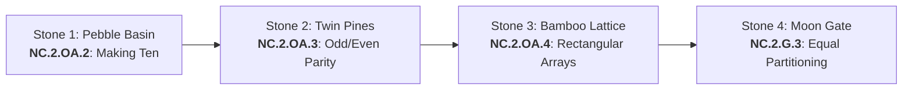

# The Zen Garden of Learning: Tactile Karesansui Math Sanctuary

- **Author:** Technical Design Team & EGM Architecture Swarm (`zen-architect`)
- **Status:** Approved (Architecture Finalized · Ready for Implementation)
- **Date:** 2026-11-16
- **Branch:** `feature/zen-garden-landing`
- **Target Repository:** `https://github.com/asub927/egm-looseleaf-experiment`
- **Target Standards:** NC.2.OA.2, NC.2.OA.3, NC.2.OA.4, NC.2.G.3 (North Carolina Grade 2 Mathematics)
- **Interactive Deliverables:**
  - `src/components/landing/ZenGardenLanding.tsx` (Landing page shell & Tobi-ishi navigation)
  - `src/components/landing/DovetailZenToy.tsx` (Tactile dovetail joinery hero manipulative)
  - `public/zen-garden-landing.html` (Zero-dependency standalone HTML5 preview)
  - `src/App.tsx` (Seamless View-Transition standard routing)

---

## 1. Overview & Core Philosophy

The **Zen Garden of Learning** is an offline-first, tactile North Carolina Grade 2 mathematics sanctuary. It replaces the frantic, hyper-stimulating, gamified clutter of conventional elementary EdTech with a contemplative, physical learning environment inspired by two timeless design traditions:

1. **Japanese Karesansui (枯山水) Dry Landscape Gardens**: Raked sand wave ripples (Samon / 砂紋), smooth river stones (Tobi-ishi / 飛び石), organic moss mounds, weathered granite, and natural Japanese cedar (_Cryptomeria japonica_) and Hinoki cypress trays.
2. **Grimm's Spiel & Holz / Pok Pok Dyed Wood Toys**: Handcrafted, tactile birch and maple joinery toys stained with rich, non-toxic water-based mineral pigments (Strawberry Coral, Sage Emerald Mint, Sunshine Honey, Blueberry Azure, Royal Lavender) featuring visible wood grain, soft chamfered edges, and precise dovetail mortise-and-tenon interlocking joints.

```
┌──────────────────────────────────────────────────────────────────────────────────────────────┐
│                                 THE ZEN GARDEN OF LEARNING                                   │
├──────────────────────────────────────────────┬───────────────────────────────────────────────┤
│ 1. Core Visual Metaphor                      │ Karesansui Dry Sand Garden & Dyed Wood Toys   │
│ 2. Spatial Learning Progression              │ 4 Tobi-ishi (Stepping Stone) Learning Phases  │
│ 3. Hero Interactive Manipulative             │ Dovetail Joinery Toy with Elevation Physics   │
│ 4. Kinetic Haptics                           │ 3D Elevation (-14px) & Magnetic Snap Basin    │
│ 5. Acoustic Engineering                      │ Resonant Hollow Wood "THOCK" & Kalimba Chimes │
│ 6. Ripple Dynamics                           │ Snap-Triggered Sand Reverberation Wavefronts  │
│ 7. Classroom Envelope                        │ < 120 MB RAM · 60 FPS Compositor · 100% COPPA │
└──────────────────────────────────────────────┴───────────────────────────────────────────────┘
```

The landing page is **not a passive marketing billboard**. It is an immediate tactile sandbox where second-grade students and educators instantly manipulate wood blocks, hear hollow wooden resonances, watch sand waves ripple across the stone garden, and traverse stepping stones directly into North Carolina Grade 2 curriculum wireframes.

---

## 2. The Problems Solved: The Anti-Clipart Guarantee

Elementary educational software frequently suffers from four critical pathologies that harm young learners:

### 1. The Cluttered "Casino Arcade" Trap

Standard commercial math platforms bombard 7- and 8-year-old children with spinning coins, flashing particle confetti, neon countdown timers, and shrieking synthesized brass fanfares. This sensory overload triggers cognitive fatigue and superficial dopamine-seeking rather than deep spatial reasoning and mathematical contemplation.

- **The Zen Garden Solution**: The garden provides profound visual stillness. Soft raked sand lines, muted moss greens, and warm cedar wood tones create a calming, focused classroom atmosphere where mathematics feels natural, grounded, and dignified.

### 2. Patronizing Clipart & Visual Infantilization

Generic cartoon animals with exaggerated grins, low-resolution vector clipart, and sticker-book aesthetics insult the innate intelligence of young children and age poorly.

- **The Zen Garden Solution**: **Zero Clipart Guarantee**. All visual elements are authentic procedural textures, SVG geometric cuts, physical wood grain, and tactile stationery primitives from the Looseleaf engine. Every shape is an honest physical manipulative.

### 3. The 400L Reading Barrier & Instructions Bloat

Second graders decode written text at approximately 400L. Landing pages burdened with explanatory paragraphs, modal tutorials, and text walls create an immediate literacy gatekeeper that blocks math exploration.

- **The Zen Garden Solution**: **Self-Explaining Spatial Affordances**. Carved negative router recesses, beveled dovetail tenons, and glowing snap basins visually communicate exact tactile affordances without requiring a single sentence of instructional text.

### 4. Low-Spec Hardware Thrashing on School Chromebooks

Heavy video loops, unoptimized 3D WebGL canvases, and unthrottled JavaScript physics engines cause budget classroom Chromebooks (Intel Celeron / ARM, 4 GB RAM) to drop frames, thermal-throttle, and crash browser tabs.

- **The Zen Garden Solution**: Pure CSS compositor-driven animations (`transform`, `opacity`), lightweight 2D canvas sand ripples sleeping when quiescent, and Node 26 headless math evaluators that guarantee 60 FPS at $< 120\text{ MB}$ memory consumption.

---

## 3. Aesthetic Metaphor: Karesansui Harmonized with Dyed Wood

The visual hierarchy bridges natural organic tranquility with vibrant mathematical logic:

```
               [ Ambient Gentle Atmosphere: Motes & Raked Sand Waves ]
                                        │
           ┌────────────────────────────┴────────────────────────────┐
           ▼                                                         ▼
┌──────────────────────────────────────┐  ┌──────────────────────────────────────┐
│       KARESANSUI DRY GARDEN          │  │       GRIMM'S DYED WOOD TOYS         │
├──────────────────────────────────────┤  ├──────────────────────────────────────┤
│ • Raked Sand Ripple Lines (Samon)    │  │ • Strawberry Coral (#ee5253): 1st Row│
│ • Natural Cedar & Hinoki Trays       │  │ • Sage Emerald Mint (#10ac84): Soln  │
│ • Smooth River Stones (Tobi-ishi)    │  │ • Sunshine Honey (#ffa502): Base Team│
│ • Velvety Moss Mounds & Lanterns     │  │ • Blueberry Azure (#1e90ff): Partner │
│ • Milled Recesses & Brass Inlays     │  │ • Royal Lavender (#8854d0): Column   │
└──────────────────────────────────────┘  └──────────────────────────────────────┘
```

### Color Palette & Visual Ground Truth

| Surface / Material     | Hex Token / Gradient              | Role & Optical Purpose                                           | Invariant Rule                                                       |
| :--------------------- | :-------------------------------- | :--------------------------------------------------------------- | :------------------------------------------------------------------- |
| **Raked Garden Sand**  | `#f7f4ee` $\rightarrow$ `#ece7dc` | Matte, fine-grain sand bed with subtle procedural raked waves    | High contrast against stained wood; non-glare for classroom lighting |
| **Sand Ripple Groove** | `rgba(180, 165, 145, 0.35)`       | Carved parallel wave troughs (2.5px stroke, soft curve)          | Rendered via static SVG pattern or low-overhead canvas layer         |
| **Hinoki Cedar Tray**  | `#d4a373` $\rightarrow$ `#bc6c25` | Warm perimeter tray with beveled wood borders                    | Holds the hero dovetail workbench and curriculum stepping stones     |
| **River Basalt Stone** | `#3d405b` $\rightarrow$ `#2b2d42` | Smooth, tumbled river stones (Tobi-ishi) acting as phase portals | Subtle white stone ring highlights, organic irregular pill contours  |
| **Velvet Garden Moss** | `#2d6a4f` $\rightarrow$ `#1b4332` | Soft organic mounds nestling the cedar trays                     | Procedural double-drop shadow for organic soft elevation             |
| **Milled Wood Recess** | `#e2dac9` + inset shadow          | Routed mortise pockets waiting for interlocking tenon blocks     | Inset shadow: `inset 0 4px 10px rgba(50, 40, 30, 0.28)`              |
| **Strawberry Coral**   | `#ff6b81` $\rightarrow$ `#ee5253` | Primary active addend / focal manipulative block                 | Grimm's non-toxic dye tone; known addend / row 1                     |
| **Sage Emerald Mint**  | `#2ed573` $\rightarrow$ `#10ac84` | Calming solution complement / goal piece                         | Grimm's non-toxic dye tone; missing complement / solution            |
| **Sunshine Honey**     | `#ffa502` $\rightarrow$ `#ff7f50` | Secondary baseline grouping / parity right team                  | Grimm's non-toxic dye tone; parity team A                            |
| **Blueberry Azure**    | `#70a1ff` $\rightarrow$ `#1e90ff` | Cool secondary row / parity left partner dowel                   | Grimm's non-toxic dye tone; parity team B                            |
| **Royal Lavender**     | `#a55eea` $\rightarrow$ `#8854d0` | Foundational array / geometry quadrant                           | Grimm's non-toxic dye tone; structured parity column                 |

---

## 4. Application-Wide Zen Garden Theme Architecture (`data-theme="zen"`)

The Zen Garden of Learning is not confined to the landing sanctuary; it serves as a primary, persistent application-wide desk theme bridging the landing page and all three North Carolina Grade 2 mathematics wireframes (`NC2OA3Wireframe`, `NC2OA4Wireframe`, `NC2GWireframe`).

```
┌─────────────────────────────────────────────────────────────────────────────────────────────┐
│                          APPLICATION-WIDE THEME INTEGRATION                                 │
├─────────────────────────────────────────────────────────────────────────────────────────────┤
│  [ Zen Garden Landing Sanctuary ] ──(Tobi-ishi Portal)──> [ Grade 2 Curriculum Desks ]      │
│  • Karesansui Raked Sand Canvas                          • NC.2.OA.2 Pebble Ten-Frame       │
│  • Hinoki Cedar Workbench & River Stones                 • NC.2.OA.3 Twin Pines Parity Mat  │
│  • Washi Paper Stationery Overlays                       • NC.2.OA.4 Bamboo Lattice Array   │
│  • Unified [data-theme="zen"] CSS Variables              • NC.2.G.3 Moon Gate Geometry Pan  │
└─────────────────────────────────────────────────────────────────────────────────────────────┘
```

### Looseleaf Desk Theme Codification

The profile storage engine (`src/lib/storage/profile.ts`) codifies `zen` as a first-class member of `StudentTheme`:

```typescript
export type StudentTheme = "honey" | "sky" | "cork" | "meadow" | "studio" | "zen"
```

### Visual Ground Truth: Karesansui Sand & Washi Paper Tokens

In `src/index.css`, the `[data-theme="zen"]` theme overrides the Looseleaf CSS custom properties to establish a calm, contemplative surface:

```css
[data-theme="zen"],
:root[data-theme="zen"] {
  --ll-desk: #f4ede4; /* Fine-grain Karesansui dry garden sand */
  --ll-desk-deep: #e5dacb; /* Deep raked ripple groove & Samon contour shadow */
  --ll-paper: #fffdfa; /* Handcrafted fibrous Japanese washi paper */
  --ll-card: #f9f5ee; /* Warm unbleached kozo index card surface */
  --ll-paper-shade: #ede3d4; /* Soft raked sand crease shadow */
}
```

### Pedagogical & Ergonomic Benefits

1. **Visual Continuity Across Modes**: When a student traverses a Tobi-ishi stepping stone from the Zen Garden landing sanctuary into a curriculum desk (such as the Array Board, Pairing Mat, or Geometry Pan), the desk surface maintains serene textural harmony without sudden chromatic shifts.
2. **Glare Reduction for Budget Classroom Displays**: Budget Chromebook TN/IPS screens often suffer from harsh blue-light wash and glare under fluorescent classroom lighting. The warm sand tone (`#f4ede4`) and washi paper surface (`#fffdfa`) reduce ocular fatigue, fostering extended contemplative focus.
3. **Curriculum Theme Picker Integration**: Each Grade 2 curriculum wireframe header includes a dedicated Zen Garden theme button (`[ ⛩️ Zen ]`) alongside traditional classroom themes (`[ 🍯 Honey ]`, `[ ☁️ Sky ]`, `[ 🪵 Cork ]`, `[ 🌿 Meadow ]`, `[ 🎨 Studio ]`). Selecting `zen` persists to local client storage via `setThemePreference("zen")`.

---

## 5. The 4 Tobi-ishi Stepping Stone Learning Path

Students traverse the Zen Garden across four organic river stones (Tobi-ishi / 飛び石). Each stone embodies a core standard of North Carolina Grade 2 Mathematics, expressed through physical wood manipulatives:



```
       ┌─────────────────────────────────────────────────────────────────┐
       │                 THE TOBI-ISHI STEPPING STONE PATH               │
       └─────────────────────────────────────────────────────────────────┘
                [ Stone 1: Pebble Basin ]      NC.2.OA.2 (Making Ten)
                            │
                            ▼
                [ Stone 2: Twin Pines ]        NC.2.OA.3 (Odd & Even)
                            │
                            ▼
                [ Stone 3: Bamboo Lattice ]    NC.2.OA.4 (Arrays 5x5)
                            │
                            ▼
                [ Stone 4: Moon Gate ]         NC.2.G.3  (Geometry)
```

### Phase 1: Pebble Basin (`NC.2.OA.2` — Making Ten & Fluency within 20)

- **Visual & Tactile Metaphor**: A carved stone water basin (Tsukubai / 蹲踞) lined with smooth river pebbles resting in a 10-frame milled birch tray.
- **Manipulative Action**: Six Strawberry Coral pebbles sit flush in the left slots. Four empty carved depressions remain. Placing the four-peg Sage Mint block completes the 10-frame with a deep, satisfying wooden _thock_.
- **Mathematical Invariant**: Ten-frame spatial conservation: $6 + 4 = 10$; $10 - 6 = 4$.
- **Navigation Target**: Launches foundational fluency mode / making-ten exploration.

### Phase 2: Twin Pines (`NC.2.OA.3` — Odd & Even Parity via Dual Columns)

- **Visual & Tactile Metaphor**: Two weathered wooden pine dowel tracks set in balance across a cedar garden bridge.
- **Manipulative Action**: Royal Lavender pegs on the left and Sunshine Honey pegs on the right. A loose Blueberry Azure dowel seeks its buddy. If every peg has an opposite partner, the tray achieves level horizontal balance (EVEN). If one peg sits alone without a partner, the balance tilts gently (ODD).
- **Mathematical Invariant**: Parity as 2-column symmetry: $2k$ (even) vs $2k + 1$ (odd) up to 20.
- **Navigation Target**: Launches `NC2OA3Wireframe` (`[🌰 Odd & Even]`).

### Phase 3: Bamboo Lattice (`NC.2.OA.4` — Rectangular Arrays & Repeated Addition)

- **Visual & Tactile Metaphor**: An interlocking bamboo lattice garden fence constructed from horizontal cedar slats and vertical dovetail rails.
- **Manipulative Action**: A $3 \times 4$ array tray. Rows 1 and 2 are locked in place. The student lifts Row 3 (Strawberry Coral) and drops it into the dovetail grooves. The teeth interlock with a rhythmic triple-thock cascade (`thock-thock-thock`), creating a rigid $3 \times 4$ matrix.
- **Mathematical Invariant**: Repeated addition of equal groups: $4 + 4 + 4 = 12$; 3 rows of 4.
- **Navigation Target**: Launches `NC2OA4Wireframe` (`[🍪 Arrays]`).

### Phase 4: Moon Gate (`NC.2.G.3` — Geometry Partitioning & Equal Shares)

- **Visual & Tactile Metaphor**: A circular wooden Japanese Moon Gate (Enso / 円相) and rectangular tatami frame partitioned into equal geometric shares.
- **Manipulative Action**: A circular routed tart tray with two $\frac{1}{3}$ wedges in place. Sliding the third curved wedge into the empty sector forms an unbroken circle with seamless wood-grain continuity.
- **Mathematical Invariant**: Partitioning circles and rectangles into 2 halves, 3 thirds, and 4 fourths without premature fraction notation ($\frac{a}{b}$), using verbal shares (_"three thirds make one whole"_).
- **Navigation Target**: Launches `NC2GWireframe` (`[📐 Geometry]`).

---

## 6. Hero Manipulative: Dovetail Joinery Interactive Engine

The hero element of the landing page is the interactive **`DovetailZenToy.tsx`** component mounted on a warm cedar workbench in the center of the garden.

```
┌─────────────────────────────────────────────────────────────────────────────┐
│                          CEDAR WORKBENCH CONTAINER                          │
│  ┌───────────────────────────────────────────────────────────────────────┐  │
│  │                     MILLED MORTISE TRAY (TARGET)                      │  │
│  │   ┌───────────────┐ ┌───────────────┐ ┌───────────────────────────┐   │  │
│  │   │ Tenon Slot 1  │ │ Tenon Slot 2  │ │  Open Router Pocket       │   │  │
│  │   │ (Seated Coral)│ │ (Seated Blue) │ │  (Target Snap Basin ±50px)│   │  │
│  │   └───────────────┘ └───────────────┘ └───────────────────────────┘   │  │
│  └───────────────────────────────────────────────────────────────────────┘  │
│                                                                             │
│                     [ ACTIVE DRAGGABLE DOVETAIL PIECE ]                     │
│                     • Elevation: translateY(-14px)                          │
│                     • Dynamic Cast Drop Shadow                              │
│                     • Magnetic Ease-Out Snap into Basin                     │
│                     • Procedural Audio "THOCK"                              │
│                     • Dispatches Sand Ripple to Garden                      │
└─────────────────────────────────────────────────────────────────────────────┘
```

### Kinetic Haptic Invariants

1. **True 3D Tactile Elevation**:
   - At rest: `transform: translateY(0px) scale(1)`, shadow: `0 3px 6px rgba(44, 39, 36, 0.25)`.
   - On pointer down / drag active: `transform: translateY(-14px) scale(1.06)`, shadow: `0 22px 35px -6px rgba(44, 39, 36, 0.38), 0 10px 14px -4px rgba(44, 39, 36, 0.2)`.
   - Transition: `transform 180ms cubic-bezier(0.34, 1.56, 0.64, 1)` (spring release) and `box-shadow 180ms ease-out`.

2. **Magnetic Snap Attraction Basin**:
   - Capture radius: $\Delta x, \Delta y \le \pm 50\text{px}$ from target mortise center.
   - Snapping trajectory: Instant magnetic ease-out latching (`cubic-bezier(0.16, 1, 0.3, 1)` in $120\text{ms}$).
   - Micro-recoil impulse: $1.5\text{px}$ overshoot settle simulating solid physical wood-on-wood impact.

3. **Sand Ripple Reverberation Dispatch**:
   - Upon successful joinery latch, `DovetailZenToy` triggers an `onSnap` callback with coordinates:
     ```typescript
     export interface DovetailSnapEvent {
       blockId: string
       targetSlotId: string
       clientX: number
       clientY: number
     }
     ```
   - The parent `ZenGardenLanding` component receives this event and propagates an expanding concentric sand wave ripple across the raked canvas originating from the snap coordinates.

4. **Keyboard Accessibility Contract**:
   - `Tab` / `Shift+Tab`: Roving focus across draggable dovetail blocks and target slots.
   - `Space` / `Enter`: Pick up focused piece / Place piece into currently targeted pocket.
   - `ArrowLeft` / `ArrowRight` / `ArrowUp` / `ArrowDown`: Stepwise spatial nudge ($10\text{px}$ normal, $40\text{px}$ with `Shift`).
   - `Escape`: Return piece to tray origin with spring ease.
   - ARIA live region announces placement status (_"Mint complement block locked into ten-frame. Ten complete."_).

---

## 7. Procedural Acoustic Architecture

In accordance with Elephant-Goldfish COPPA and offline reliability requirements, the audio system uses **zero external audio files (`.mp3`, `.wav`)**. All sounds are generated procedurally on demand via the browser Web Audio API through `src/lib/audio/wood-thock-synth.ts` and `src/lib/audio/garden-chimes.ts`.

### 1. The Binaural Hollow Wood Block "THOCK"

Simulates the acoustic resonance of an authentic dense Japanese boxwood or maple block striking a hollow cedar cavity:

```typescript
/**
 * Procedural Hollow Wood Block Synthesizer.
 * Synthesizes physical impact + internal cavity air resonance.
 */
export function playWoodThock(ctx: AudioContext, pitchMultiplier: number = 1.0): void {
  const now = ctx.currentTime
  const osc = ctx.createOscillator()
  const bandpass = ctx.createBiquadFilter()
  const gain = ctx.createGain()

  // 1. Rapid Pitch Decay: Simulates sudden wood deformation and release (480Hz -> 140Hz in 65ms)
  const baseFreq = 480 * pitchMultiplier
  osc.type = "sine"
  osc.frequency.setValueAtTime(baseFreq, now)
  osc.frequency.exponentialRampToValueAtTime(baseFreq * 0.29, now + 0.065)

  // 2. High-Q Bandpass Filter: Models resonant chamber acoustics of hollow cedar
  bandpass.type = "bandpass"
  bandpass.frequency.setValueAtTime(580 * pitchMultiplier, now)
  bandpass.Q.setValueAtTime(7.5, now)

  // 3. Fast Exponential Envelope: Crisp attack with immediate decay
  gain.gain.setValueAtTime(0.85, now)
  gain.gain.exponentialRampToValueAtTime(0.001, now + 0.11)

  osc.connect(bandpass)
  bandpass.connect(gain)
  gain.connect(ctx.destination)

  osc.start(now)
  osc.stop(now + 0.12)
}
```

### 2. Ambient Pentatonic Kalimba / Singing Bowl Chime Toggle

- **Tone**: Soft pentatonic chime based on Japanese _Insen_ or major pentatonic scale (mapped to `src/lib/audio/garden-chimes.ts`).
- **Trigger**: Ambient sound toggle button located in the garden header (discreet stone seal icon).
- **Pedagogical Function**: Provides calming acoustic feedback during contemplative focus.

---

## 8. Classroom Hardware Envelope (< 120 MB RAM / 60 FPS)

Classroom Chromebooks have severe computational limits. The Zen Garden landing page enforces the following performance constraints:

```
┌─────────────────────────────────────────────────────────────────────────────┐
│                       CHROMEBOOK PERFORMANCE INVARIANTS                     │
├──────────────────────────────────┬──────────────────────────────────────────┤
│ Maximum Resident Memory          │ < 120 MB (Chrome Task Manager Invariant) │
│ Frame Rate Budget                │ Solid 60 FPS (Zero jank on trackpad pan) │
│ Layout Thrashing Budget          │ 0 forced reflows during active drag      │
│ Invariant Math Test Duration     │ < 250 ms total for 43 deterministic tests│
│ Network Dependencies             │ 0 bytes (100% offline service-workerable)│
└──────────────────────────────────┴──────────────────────────────────────────┘
```

### 1. Sand Ripple Canvas & SVG Wave Strategy

- **Static Raked Sand Lines**: Parallel sand wave lines (Samon) are rendered once via an SVG `<pattern>` or static SVG background with CSS `vector-effect="non-scaling-stroke"`. They incur **zero CPU cycles** while static.
- **Dynamic Wavefront Ripple**: Concentric ripples from dovetail snaps are computed using a single 2D `<canvas>` overlay or CSS keyframed SVG circles:
  - When active: Canvas renders expanding rings with quadratic alpha fade ($r(t) = r_0 + v \cdot t$, $\alpha(t) = \alpha_0 (1 - t/T)^2$).
  - When tranquil: The animation loop **completely stops (`cancelAnimationFrame`)**, drawing 0 W of CPU power.
- **Compositor-Only Motion**: Draggable blocks use `translate3d(x, y, 0)` and CSS variables. Coordinates are calculated via pointer deltas rather than DOM reading to prevent forced synchronous layouts.

---

## 9. COPPA Compliance & Absolute Privacy Guarantee

Elephant-Goldfish operates under strict educational privacy laws:

1. **Zero External HTTP / Telemetry Calls**: No Google Analytics, no Mixpanel, no Sentry, no cloud LLM API calls, no third-party CDN fonts or scripts.
2. **Zero Persistent PII**: No student names, email addresses, school IDs, or location coordinates are collected or stored.
3. **Local-Only Preferences**: Sound preferences and theme selections are stored exclusively in browser `localStorage` under `egm_*` keys.
4. **COPPA Exemption**: Because no personal data is collected or transmitted, the platform operates in full compliance with COPPA, FERPA, and North Carolina Student Online Personal Protection acts.

---

## 10. Implementation Architecture & File Partitioning

To avoid git merge collisions and maintain clean separation of concerns, the implementation is partitioned across four specialized files:

```
src/
 ├── components/landing/
 │    ├── ZenGardenLanding.tsx       (Owned by @landing-author: Main landing sanctuary & Tobi-ishi path)
 │    └── DovetailZenToy.tsx         (Owned by @interactive-toy: Interactive hero joinery manipulative)
 │
 ├── lib/audio/
 │    ├── wood-thock-synth.ts        (Procedural Web Audio wood THOCK synthesizer)
 │    └── garden-chimes.ts           (Procedural pentatonic kalimba & singing bowl chimes)
 │
 └── App.tsx                         (Owned by @landing-author: App shell standard routing & transitions)

public/
 └── zen-garden-landing.html         (Owned by @landing-author: Standalone zero-build HTML preview)
```

### Component Interface Contracts

#### 1. `DovetailZenToy.tsx` (`@interactive-toy`)

```typescript
export interface DovetailSnapDetail {
  blockId: string
  targetSlotId: string
  snappedAt: number
  clientX: number
  clientY: number
}

export interface DovetailZenToyProps {
  /** Callback fired when a dovetail tenon successfully locks into a mortise recess */
  onSnap?: (detail: DovetailSnapDetail) => void
  /** Master sound enabled flag */
  soundEnabled?: boolean
  /** Optional custom CSS class */
  className?: string
}
```

#### 2. `ZenGardenLanding.tsx` (`@landing-author`)

```typescript
export interface ZenGardenLandingProps {
  /** Handler to navigate into a curriculum wireframe standard */
  onSelectStandard: (standard: "arrays" | "parity" | "geometry") => void
  /** Current active theme */
  theme: string
  /** Theme change handler */
  onSetTheme: (theme: string) => void
}
```

#### 3. `App.tsx` Routing Integration (`@landing-author`)

Extend `ActiveStandard` to support the landing sanctuary:

```typescript
export type ActiveStandard = "landing" | "arrays" | "parity" | "geometry"
```

- Initial standard defaults to `"landing"` (or persisted `localStorage.getItem("egm_active_standard")`).
- Top navigation / stone clicks invoke `useDeskViewTransition` for seamless morphing between the garden sanctuary and the math desks.

---

## 11. Universal Verification Matrix

All deliverables must satisfy the five inviolable repository verification gates before completion:

```bash
# Gate 1: Pure Mathematical Invariants (< 250 ms budget in pure Node 26)
npm test

# Gate 2: Static Oxlint Quality (0 errors across all files)
npm run lint

# Gate 3: TypeScript Type-Safety (verbatimModuleSyntax, erasableSyntaxOnly)
npm run typecheck

# Gate 4: Vitest Component & UI Harness (React Testing Library)
npm run test:ui

# Gate 5: Production Bundle Compilation (Vite 8 production release)
npm run build

# Composite Pre-Flight Gate
npm run check && npm run test:ui
```

### Aesthetic & Usability Acceptance Checklist

- [ ] **Zero Clipart**: No cartoon stickers, low-res emojis, or garish gamification icons.
- [ ] **Authentic Japandi Palette**: Sand, river stone, hinoki cedar, and Grimm's non-toxic stained wood tones.
- [ ] **Haptic Elevation**: Grabbing a block elevates it by $-14\text{px}$ with expanded cast shadow.
- [ ] **Magnetic Snap & THOCK**: Moving within $\pm 50\text{px}$ latches the piece with a hollow wooden thock.
- [ ] **Sand Reverberation**: Snapping triggers a gentle, expanding concentric ripple across the garden sand.
- [ ] **Tobi-ishi Navigation**: Clicking any of the 4 stepping stones transitions cleanly into its respective NC Grade 2 curriculum module.
- [ ] **Chromebook Envelope**: Memory remains $< 120\text{ MB}$, animations maintain 60 FPS, zero layout thrashing.
