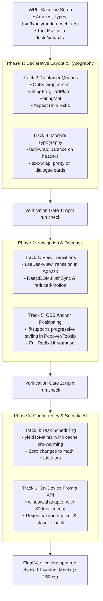

# Modern Web Guidance Modernization: 6-Track Architectural Migration

- **Author:** Elephant-Goldfish Architecture Swarm (Synthesized from 6-Lens Goldfish Review)
- **Date:** 2026-11-15
- **Target Repository:** `elephant-goldfish`
- **Target Platform:** Chromium-based browsers on elementary classroom Chromebooks (4 GB RAM, Celeron/ARM CPUs, ChromeOS LTS)
- **Status:** Step 3: Synthesized Goldfish Brief (Review Complete)

---

## Overview

This feature plans the progressive adoption of Google Chrome's **Modern Web Guidance** standards into Elephant Goldfish—an offline-first, tactile North Carolina Grade 2 mathematics desk built with React 19, TypeScript, Vite, Tailwind CSS v4, and the Looseleaf procedural ink engine.

The current application relies on full component unmounts during navigation, legacy coordinate calculations, synchronous rendering loops, and third-party UI layers. Adopting Modern Web Guidance modernizes these areas using native Chromium platform capabilities (same-document View Transitions, Container Queries, cooperative task yielding, modern typography, native Popover attributes, and on-device machine learning).

However, rigorous evaluation across 6 Goldfish review lenses reveals critical hardware, pedagogical, and toolchain hazards. On elementary classroom Chromebooks with 4 GB shared memory, attempting unconstrained on-device AI model execution triggers low-memory browser crashes (`SIGKILL`). Furthermore, introducing asynchronous browser APIs into pure mathematical evaluators breaks the repository's 43 deterministic invariant tests in Node 26.

This brief establishes a phased, progressively enhanced architecture that secures the benefits of Modern Web Guidance while preserving the application's strict non-negotiables: **100% offline functionality, zero telemetry, COPPA privacy compliance, deterministic mathematical ground truth, and a 100% pass rate on all pedagogical invariants.**

---

## Analysis

The 6-track proposal was evaluated by 6 independent Goldfish reviewers (`egm-design`, `egm-codebase-details`, `egm-zoom-out`, `egm-comprehension`, `egm-implementation-readiness`, and `egm-structural`). Overlapping points have been deduplicated into the following cohesive findings.

### 1. Hardware Ceilings and Invariant Safety in On-Device AI (Track 6)

- **Lenses**: `egm-design`, `egm-zoom-out`, `egm-codebase-details`, `egm-comprehension`
- **Finding**: The Chrome Prompt API (`window.ai` / Gemini Nano) requires 4 GB VRAM and gigabytes of storage. Second-grade classroom Chromebooks (e.g., Lenovo 100e/300e) run dual-core Intel Celeron or ARM processors with 4 GB total shared RAM and minimal free disk. Initializing local models risks Out-Of-Memory (OOM) browser crashes. On first launch, downloading weights across 30 classroom devices would saturate school Wi-Fi with over 40 GB of concurrent data. Furthermore, LLM generation takes 800ms to 8,000ms. If a student moves a token while an LLM generates text, an asynchronous race condition corrupts the synchronous state machine (`scaffolding-machine.ts`). Most critically, LLMs can hallucinate prohibited fraction numerals (`1/2`, `3/4`), violating North Carolina Grade 2 standards that mandate verbal share vocabulary.
- **Resolution**: Ground-truth math evaluation remains pure numeric code in `src/lib/math/`. The primary Socratic tutoring baseline remains the existing 3-tier deterministic state machine (`useGeometryScaffolding`). `window.ai` is strictly an optional progressive enhancement:
  1. It is gated behind `window.ai?.languageModel?.capabilities()` returning `readily: "readily"`. If unready or absent, the app falls back silently with zero loading indicators.
  2. All generation runs through an `AbortController` that cancels generation immediately if the student touches any manipulative.
  3. A strict regex filter rejects any output containing fraction numerals (`/\b\d+\/\d+\b/`), falling back to hardcoded strings within an 800ms timeout budget.

### 2. Radical Scope Discipline vs. Speculative Over-Engineering (Tracks 3, 5, 6)

- **Lenses**: `egm-zoom-out`, `egm-codebase-details`, `egm-structural`
- **Finding**: Eighty percent of tangible classroom value is unlocked by less than 60 lines of declarative CSS and 5 lines of React in Tracks 1, 2, and 4. In contrast, Tracks 3, 5, and 6 introduce heavy risk:
  - Replacing `@radix-ui` (Track 5) with native Popovers and CSS Anchor Positioning reinvents existing, accessible components. Radix UI already manages focus loops, keyboard trapping, and screen-reader ARIA states. Furthermore, ChromeOS LTS channels often lag behind modern Anchor Positioning syntax changes (Chrome 125 vs. 128).
  - Injecting `scheduler.yield()` (Track 3) into mathematical evaluators or test loops breaks Node 26 invariant tests where `scheduler` is undefined. Moreover, procedural ink frames are generated synchronously in React `useMemo`; making ink generation asynchronous returns unresolved Promises and crashes component renders.
- **Resolution**: Drop the full rewrite of Radix UI. Keep Radix as the structural and accessibility backbone, using CSS Anchor Positioning purely as an additive `@supports` progressive enhancement. Confine `scheduler.yield()` to background cache pre-warming and interactive time-slicing loops (`src/lib/ink/react/cache.ts`), keeping mathematical evaluators and Node invariant tests strictly synchronous.

### 3. Coordinate Space Integrity in Container Queries and Drag Snapping (Track 2)

- **Lenses**: `egm-codebase-details`, `egm-design`, `egm-structural`, `egm-comprehension`
- **Finding**: Interactive manipulatives (`BakingPan`, `TartPlate`, `PairingMat`) rely on the zero-dependency pointer snapping engine (`declarative-drag.ts`), which converts screen coordinates to SVG viewBox space using `svg.getScreenCTM()?.inverse()`. If CSS Container Queries alter container dimensions or aspect ratios dynamically while a child drags a divider, the current transformation matrix (CTM) becomes invalid. This causes the Schmitt-trigger snapping threshold ($\pm 5\%$ enter, $\pm 10\%$ release) to distort, producing pointer jitter and false `unequal_shares` evaluations.
- **Resolution**: Maintain a strict separation between fluid outer layout and logical SVG coordinates. Outer wrappers use `@container (inline-size)`. Interactive SVGs retain fixed, immutable `viewBox` definitions (e.g. `viewBox="0 0 800 500"`) locked to exact aspect ratios (`aspect-[16/10]` for pans, `aspect-square` for plates) with `preserveAspectRatio="xMidYMid meet"`. Snapping calculations remain normalized to $[0, 1]$ intervals, completely decoupled from container query units.

### 4. Same-Document View Transition Execution in React 19 (Track 1)

- **Lenses**: `egm-codebase-details`, `egm-design`, `egm-structural`
- **Finding**: In React 19, `setActiveStandard` executes concurrent reconciliation. Invoking `document.startViewTransition(() => setActiveStandard(target))` without flushing updates causes the browser to snapshot identical pre- and post-DOM states, aborting the transition. Rapid clicking by students triggers `InvalidStateError` because a previous transition is in flight. Additionally, GPU texture capture across full-screen Looseleaf procedural noise and SVG filter trees thrashes fill rates on Intel Celeron GPUs.
- **Resolution**: Wrap transitions in a helper function (`useDeskViewTransition`) combining `document.startViewTransition` with `ReactDOM.flushSync`. The helper includes an active transition lock to prevent overlapping rejections. Restrict `view-transition-name` to top-level workbench containers (`desk-stage`, `mascot-dock`), explicitly excluding procedural background textures and paper grain SVG definitions. Enforce immediate bypass if `prefers-reduced-motion: reduce` is active or if `startViewTransition` is unsupported.

### 5. Layout Stability in Modern Typography and Collapsible Drawers (Track 4)

- **Lenses**: `egm-codebase-details`, `egm-design`, `egm-comprehension`
- **Finding**: `text-wrap: balance` runs an iterative line-breaking algorithm. Applying it to dynamic narrative dialogue during word-by-word subtitle highlighting forces Chromium to recalculate text layouts on every word, consuming CPU on low-spec devices. Furthermore, using `interpolate-size: allow-keywords` to animate hint cards from height `0` to `auto` pushes tactile math manipulatives downward while a student is interacting.
- **Resolution**: Restrict `text-wrap: balance` strictly to static card headers and standard titles under 3 lines. Dialogue cards and Socratic speech bubbles must use `text-wrap: pretty` (orphan prevention without quadratic re-balancing). Scaffolding containers must maintain fixed minimum heights or animate via GPU transforms (`opacity`, `transform: translateY`) rather than expanding heights, preventing layout shifts on active workbenches.

### 6. Node 26 Test Harness Isolation and Pre-Commit Gate (All Tracks)

- **Lenses**: `egm-implementation-readiness`, `egm-codebase-details`, `egm-design`
- **Finding**: The repository's invariant test matrix (`tests/invariants/*.test.ts`) runs directly under Node 26 using native TypeScript stripping (`node --experimental-strip-types`). Node 26 does not provide `window`, `document`, or `scheduler`. Any direct reference to browser globals in shared mathematical code causes `ReferenceError` crashes. Furthermore, injecting microtask delays into invariant fuzzing loops breaches the `< 150ms` pre-commit speed budget.
- **Resolution**: Pure mathematical evaluators in `src/lib/math/` and test suites in `tests/invariants/` remain 100% synchronous and headless. All browser APIs must be isolated inside browser-only hooks (`src/hooks/`) or client-side utilities with platform guards (`typeof window !== "undefined"`). Ambient TypeScript interfaces (`src/types/modern-web.d.ts`) must be established before worker agents modify runtime code.

### 7. Autonomous Swarm Governance (Option B)

- **Lenses**: `egm-implementation-readiness`, `egm-design`, `egm-zoom-out`
- **Finding**: Deploying 6 uncoordinated worker agents concurrently modifying shared files (`App.tsx`, wireframes, `index.css`) causes git merge collisions, duplicate Tailwind imports, and broken builds. Running only Node 26 tests leaves the verifier blind to DOM rendering failures in Chromium.
- **Resolution**: Serialize execution into 3 phased work packages with strict file partitioning. Upgrade the Continuous Verifier gate to run both Node 26 invariant tests (`npm test`) and full build checks (`npm run check` including `tsc -b` and `vite build`).

---

## Goals vs. Non-Goals

### In-Scope Goals

- **Track 1 (View Transitions)**: Add same-document view transitions for top-level navigation in `src/App.tsx` across Arrays, Parity, and Geometry, wrapped in `ReactDOM.flushSync` and guarded by `prefers-reduced-motion`.
- **Track 2 (Container Queries)**: Add `@container (inline-size)` utilities to outer manipulative desk wrappers while locking inner SVG aspect ratios (`aspect-[16/10]`) to protect coordinate accuracy.
- **Track 3 (Task Scheduling)**: Introduce a platform-isolated `yieldToMain()` utility in `src/lib/utils/scheduler.ts` and apply it to procedural ink cache pre-warming, keeping math evaluators synchronous.
- **Track 4 (Modern Typography)**: Apply `text-wrap: balance` to static titles, `text-wrap: pretty` to dialogue cards, and `@supports (interpolate-size: allow-keywords)` for drawer styling.
- **Track 5 (Anchor Positioning)**: Progressively augment existing Radix UI popovers and tooltips with CSS Anchor Positioning (`position-anchor`), retaining full Radix accessibility and keyboard navigation.
- **Track 6 (Built-In AI Scaffolding)**: Implement an optional, on-device Socratic tutoring bridge via the Chrome Prompt API (`window.ai`), protected by an 800ms timeout, `AbortController` cancellation on student gestures, and a regex fraction filter.
- **Zero Telemetry / COPPA Integrity**: Maintain 100% client-side operation with zero persistent storage of student AI conversations and zero external network traffic.
- **Invariant Release Gate**: Guarantee 100% pass rates across all 43 deterministic invariant tests within the `< 150ms` execution budget.

### Out-of-Scope Non-Goals

- **No LLM Mathematical Evaluation**: LLMs are strictly forbidden from evaluating answers, determining parity, or validating geometry partitions.
- **No Radix UI Deprecation**: Wholesale replacement of `@radix-ui` primitives with bare HTML elements is excluded to prevent accessibility regressions.
- **No Async Test Invariants**: Invariant test suites in `tests/invariants/` will not use `scheduler.yield()` or asynchronous promises.
- **No Microscopic View Transitions**: Individual cookie counters, chestnuts, and fraction dividers will not carry per-token transition names.
- **No Dynamic SVG Resizing Mid-Drag**: Manipulative SVGs will not change aspect ratios during active pointer manipulation.
- **No Cloud AI Fallbacks**: No remote cloud LLM endpoints (Gemini Developer API, OpenAI, etc.) will be contacted if on-device AI is absent.

---

## Alternatives Weighed

| Decision Area              | Selected Approach                                                                     | Rejected Alternative                                                   | Reason for Rejection                                                                                                   |
| :------------------------- | :------------------------------------------------------------------------------------ | :--------------------------------------------------------------------- | :--------------------------------------------------------------------------------------------------------------------- |
| **Socratic Tutoring**      | Deterministic 3-tier ladder as baseline; optional `window.ai` progressive enhancement | LLM as mandatory tutoring engine                                       | Causes OOM crashes on 4 GB Chromebooks, triggers 40 GB classroom network downloads, and risks fraction hallucinations. |
| **Overlay Architecture**   | Retain Radix UI; augment with CSS Anchor Positioning                                  | Full migration to native HTML `<dialog>` and `popover`                 | Strips tested keyboard trapping, focus restoration, and screen-reader ARIA states; breaks HappyDOM test runner.        |
| **Task Scheduling**        | Isolated `yieldToMain()` in background ink cache loops                                | Injecting `scheduler.yield()` into math evaluators and fuzzing loops   | Breaks Node 26 invariant test execution (`ReferenceError`); breaches pre-commit `< 150ms` time budget.                 |
| **Navigation Transitions** | Centralized `useDeskViewTransition` with `flushSync` and reduced-motion guard         | Uncoordinated `document.startViewTransition` calls in child components | Triggers `InvalidStateError` on rapid clicks; React 19 concurrent updates fail to snapshot correctly.                  |
| **Manipulative Scaling**   | Outer `@container (inline-size)` with fixed SVG aspect ratios                         | Unconstrained fluid scaling on SVG viewBox elements                    | Invalidates `svg.getScreenCTM()` during active pointer dragging, causing magnetic snapping miscalculations.            |
| **Swarm Orchestration**    | Phased, serialized execution with strict file ownership                               | Uncoordinated 6-worker concurrent swarm                                | Generates severe git merge conflicts in shared files (`App.tsx`, `index.css`) and breaks builds.                       |

---

## Key Decisions & Staging for Next Steps

### Key Technical Decisions

1. **WP0 Prerequisite**: Create `src/types/modern-web.d.ts` with ambient interfaces for `Window.ai`, `Scheduler.yield`, and `Document.startViewTransition` before worker agents write code.
2. **Evaluator Isolation**: Mathematical evaluator files (`src/lib/math/`) and invariant test suites (`tests/invariants/`) are locked as read-only for modern web refactoring.
3. **Graceful Degrade Contract**: Every modern platform feature must degrade silently:
   - Missing View Transitions $\rightarrow$ immediate synchronous state update.
   - Missing Anchor Positioning $\rightarrow$ standard absolute CSS positioning.
   - Missing or unready `window.ai` $\rightarrow$ instant deterministic static hint string.
   - Missing `scheduler.yield` $\rightarrow$ synchronous `Promise.resolve()`.
4. **Local Observability**: Since cloud telemetry is prohibited by COPPA, create a zero-PII local circular ring buffer (`DiagnosticLogger`, max 100 entries) recording feature capability flags and evaluator outcomes, inspectable via root DOM attributes (`data-ai-engine="nano"|"fallback"`).

---

### Phased Execution Staging

#### Phase 1: Declarative Layout & Typography (Tracks 2 & 4)

- **Target Files**: `src/components/math/BakingPan.tsx`, `TartPlate.tsx`, `PairingMat.tsx`, `MascotCompanion.tsx`, `src/index.css`.
- **Execution**: Add Tailwind v4 `@container` classes to desk cards. Apply `text-wrap: balance` to static headers and `text-wrap: pretty` to dialogue cards.
- **Verification Gate**: `npm run check` (Oxlint, Typecheck, 43 Invariant Tests, Build).

#### Phase 2: Navigation & Overlays (Tracks 1 & 5)

- **Target Files**: `src/App.tsx`, `src/lib/dom/view-transitions.ts`, `src/components/ui/popover.tsx`, `tooltip.tsx`, `src/index.css`.
- **Execution**: Implement `useDeskViewTransition` in `App.tsx`. Add progressive `@supports (position-anchor: --anchor)` styles to popovers while maintaining Radix UI context.
- **Verification Gate**: `npm run check` and verify that Vitest UI component tests pass under HappyDOM.

#### Phase 3: Concurrency & Offline Socratic AI (Tracks 3 & 6)

- **Target Files**: `src/lib/utils/scheduler.ts`, `src/lib/ink/react/cache.ts`, `src/lib/ai/prompt-api.ts`, `src/hooks/use-geometry-scaffolding.ts`.
- **Execution**: Implement `yieldToMain()` with time-slicing for background ink cache generation. Implement `requestSocraticHint` with strict capability checks, 800ms timeout, `AbortController` cancellation, and fraction numeral regex filtering.
- **Verification Gate**: Universal Release Gate (`npm run check`) ensuring that invariant tests in Node 26 execute with 100% pass rate in $< 150\text{ms}$.
