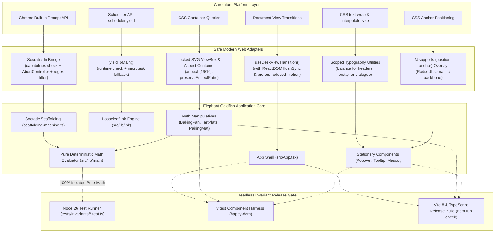

# Modern Web Guidance Modernization: 6-Track Architectural Migration

- **Author:** Elephant-Goldfish Architecture Swarm & Technical Design Team
- **Status:** DRAFT (Step 5: Detailed Implementation Complete)
- **Date:** 2026-11-15
- **Target Repository:** `https://github.com/asub927/egm-looseleaf-experiment.git`
- **Target Platform:** Chromium-based browsers on elementary classroom Chromebooks (4 GB RAM, Celeron/ARM processors, ChromeOS LTS channels)

---

## Overview

Elephant Goldfish is an offline-first, tactile North Carolina Grade 2 mathematics web application built with React 19, TypeScript, Vite, Tailwind CSS v4, Radix UI, and the Looseleaf procedural ink rendering engine. The application provides concrete, manipulative-first learning across three foundational curriculum standards:

1. **`NC.2.OA.4`**: Rectangular Arrays (`[🍪 Arrays]`)
2. **`NC.2.OA.3`**: Odd and Even Parity (`[🌰 Odd & Even]`)
3. **`NC.2.G.3`**: Geometry Partitioning Lab (`[📐 Geometry]`)

This technical design defines the progressive migration of the application to Google Chrome's **Modern Web Guidance** standards. The project updates existing application patterns by leveraging native Chromium platform capabilities:

- Same-document View Transitions for standard navigation in `src/App.tsx`.
- CSS Container Queries for responsive manipulative scaling across varied screen dimensions.
- Cooperative task yielding (`scheduler.yield()`) to preserve 60 FPS input responsiveness during heavy procedural ink rendering.
- Modern typography primitives (`text-wrap: balance` and `text-wrap: pretty`) for early-grade readability.
- Progressive CSS Anchor Positioning for tooltips and popovers while preserving Radix UI accessibility.
- Optional on-device Socratic tutoring via Chrome's Built-In Prompt API (`window.ai`).

The entire migration is governed by strict non-negotiable constraints: **100% client-side privacy, zero telemetry, full COPPA compliance, deterministic mathematical ground truth, and a 100% pass rate on all 43 pedagogical invariants.**

---

## The Problem

### 1. Spatial Disorientation from Abrupt Component Remounting

In the current application shell (`src/App.tsx`), switching between curriculum standards unmounts the active standard wireframe and mounts the target wireframe in a single render tick. For second-grade students (ages 7–8), this abrupt visual shift breaks spatial continuity. Students lose visual track of the tactile desk surface, toolbars, and companion mascot, increasing cognitive friction when moving between connected math concepts (e.g., transitioning from rectangular arrays to rectangular equal partitioning).

### 2. Viewport-Bound Breakpoints in Varied Classroom Displays

Elementary classroom Chromebooks feature diverse screen form factors, ranging from 11.6-inch displays ($1366 \times 768$) to high-DPI tablets and split-window arrangements. The current math manipulatives (`BakingPan`, `TartPlate`, `PairingMat`) rely on viewport-level utility breakpoints or fixed dimensions. When teachers open side-by-side accessibility panels or students use window splitting, manipulative trays clip, overflow, or distort, making drag targets difficult to interact with on trackpads.

### 3. Main-Thread Input Contention During Procedural Ink Generation

The Looseleaf procedural ink engine generates hand-drawn chalk strokes, stippling, paper grain noise, and SVG filters synchronously. On low-powered dual-core Celeron or ARM processors typical of school hardware, long synchronous script loops during theme changes or complex diagram renders can delay pointer event processing (increasing Interaction to Next Paint / INP latency). This introduces perceptible drag lag when students manipulate divider handles or cookie counters.

### 4. Rigid Static Scaffolding in Differentiated Learning

The companion mascot (**Pencil Pal**) currently relies on a fixed 3-tier static hint ladder (`useGeometryScaffolding`). While mathematically sound and 100% deterministic, static strings cannot dynamically rephrase guidance for second graders who struggle with specific phrasing, nor can they provide multi-lingual support (such as Spanish hints) for English Language Learners (ELL) in North Carolina public classrooms.

### 5. Third-Party Overlay Calculation Overhead

UI popovers, dialogs, and tooltips rely on `@radix-ui` and JavaScript-based floating element measurement scripts. On low-memory Chromebooks, maintaining JavaScript positioning listeners across dozens of stationery primitives consumes unnecessary CPU and memory that could be handled natively by the browser platform.

---

## Proposed Solution

A structured, 6-track modernization program delivered through progressive enhancement:

1. **Same-Document View Transitions**: Wrap top-level standard switching in `src/App.tsx` with `document.startViewTransition` and `ReactDOM.flushSync`, creating smooth paper-slide cross-fades that preserve desk spatial continuity.
2. **Container Query Scaling**: Apply `@container (inline-size)` to outer desk cards while locking inner SVG aspect ratios (`aspect-[16/10]` for rectangular pans, `aspect-square` for circular plates), ensuring tactile manipulatives scale fluidly to any container width without coordinate drift.
3. **Cooperative Concurrency**: Introduce an environment-safe `yieldToMain()` utility in `src/lib/utils/scheduler.ts` using `scheduler.yield()`, breaking up long procedural ink cache pre-warming loops without modifying synchronous mathematical evaluators or Node 26 tests.
4. **Typographic Polish**: Add `text-wrap: balance` to static section titles and `text-wrap: pretty` to Pencil Pal dialogue cards, preventing orphan words without triggering expensive layout recalculations during speech playback.
5. **Progressive Anchor Positioning**: Augment existing Radix UI popovers and tooltips with CSS Anchor Positioning (`position-anchor`), retaining Radix focus management and screen-reader ARIA states while delegating geometric placement to the browser compositor.
6. **COPPA-Compliant On-Device AI**: Implement an optional, on-device Socratic tutoring bridge via the Chrome Prompt API (`window.ai`). Gated behind an instantaneous capability check (`capabilities().readily === "readily"`), an 800ms timeout, an active gesture `AbortController`, and a regex filter rejecting fraction numerals (`\b\d+\/\d+\b/`), it provides adaptive hints with zero server telemetry and instant fallback to deterministic static hints.

---

## Goals

- **Goal 1 (Spatial Navigation Continuity)**: Provide smooth, hardware-accelerated transitions between curriculum standards in `src/App.tsx`, respecting `prefers-reduced-motion` and avoiding DOM snapshotting race conditions.
- **Goal 2 (Responsive Desk Containers)**: Allow `BakingPan`, `TartPlate`, and `PairingMat` to adapt fluidly to container widths from $320\text{px}$ to $1200\text{px}$ without distorting SVG coordinate projection matrices or breaking the Schmitt-trigger pointer snapping engine.
- **Goal 3 (Sub-16ms Input Latency / INP Protection)**: Ensure procedural ink generation yields to the browser event loop during heavy operations, preventing main-thread blocking during student pointer interactions.
- **Goal 4 (Enhanced Early-Literacy Readability)**: Prevent orphan words in Grade 2 problem descriptions and companion dialogues through native CSS text-wrapping algorithms without layout thrashing.
- **Goal 5 (Accessibility & Overlay Parity)**: Maintain 100% keyboard and screen-reader accessibility across all stationery overlays by preserving Radix UI primitives and applying CSS Anchor Positioning as a progressive enhancement.
- **Goal 6 (Zero-Telemetry On-Device AI Scaffolding)**: Provide optional on-device adaptive Socratic dialogue via `window.ai` with zero network requests, zero persistent storage of student chat text, an 800ms fallback timeout, and strict exclusion of abstract fraction numerals.
- **Goal 7 (Node 26 Invariant Test Integrity)**: Maintain a 100% pass rate across all 43 deterministic pedagogical invariant tests (`tests/invariants/*.test.ts`) running under Node 26 in $< 150\text{ms}$.
- **Goal 8 (Classroom Hardware Reliability)**: Guarantee zero white-screen crashes, zero memory leaks, and zero blocking error modals on 4 GB RAM Intel Celeron and ARM Chromebooks running ChromeOS LTS channels.

---

## Non-Goals

- **No Replacement of Mathematical Evaluators**: Generative models will never evaluate student submissions, compute rectangular dimensions, or check geometric equality. The pure numeric evaluators in `src/lib/math/` remain the sole arbiters of truth.
- **No Wholesale Deprecation of Radix UI**: Radix UI primitives will not be removed or replaced with bare HTML elements. Radix is retained for focus restoration, keyboard loops, and ARIA attributes.
- **No Remote Cloud AI Endpoints**: No cloud LLM APIs (Gemini Cloud API, OpenAI, Anthropic) will ever be contacted. If on-device `window.ai` is unavailable, the application defaults to hardcoded deterministic hints.
- **No Asynchronous Test Harness Modifications**: Invariant tests in `tests/invariants/` will not be converted to asynchronous execution or use `scheduler.yield()`.
- **No Micro-Transitions on Manipulative Tokens**: Individual cookie counters, chestnuts, and fraction dividers will not carry unique `view-transition-name` attributes to avoid GPU texture thrashing.
- **No Dynamic SVG Resizing During Pointer Capture**: The internal SVG `viewBox` coordinates and aspect ratios will not mutate while a pointer drag operation is in progress.

---

## Technical Plan & Architecture

The architecture organizes the 6 Modern Web Guidance tracks into isolated layers with explicit fallback contracts, verified against existing browser baselines and test runners.



---

### Detailed Architecture by Track

#### Track 1: Navigation Architecture (Same-Document View Transitions)

- **Module**: `src/lib/dom/view-transitions.ts` & `src/App.tsx`
- **Execution Mechanism**:
  1. Standard navigation in `src/App.tsx` invokes `useDeskViewTransition(targetStandard)`.
  2. The transition helper verifies `document.startViewTransition` availability and checks `window.matchMedia('(prefers-reduced-motion: reduce)').matches`. If reduced motion is requested or the API is absent, the state updates immediately via standard React `setActiveStandard(targetStandard)`.
  3. When supported, `document.startViewTransition` executes with `ReactDOM.flushSync(() => setActiveStandard(targetStandard))`, ensuring React 19 commits the new DOM state synchronously before the browser captures the destination snapshot.
  4. An internal boolean ref (`isTransitioningRef`) locks incoming transitions, ignoring duplicate tab clicks until the active transition promise settles.
  5. Scoped `view-transition-name` rules (`desk-stage`, `desk-toolbar`) are declared in `src/index.css`. Manipulative tokens (counters, dividers) are strictly excluded from transition names to eliminate GPU fill-rate thrashing on Intel Celeron GPUs.

#### Track 2: Fluid Desk & Manipulative Layout (CSS Container Queries)

- **Modules**: `src/components/math/BakingPan.tsx`, `TartPlate.tsx`, `PairingMat.tsx`, and `src/lib/drag/declarative-drag.ts`
- **Execution Mechanism**:
  1. The outer card wrapping each manipulative desk receives `@container (inline-size)` and `container-type: inline-size`.
  2. To prevent coordinate drift in the declarative pointer snapping engine (`declarative-drag.ts`), inner interactive SVGs retain fixed, immutable `viewBox` coordinates (`viewBox="0 0 800 500"` for pans, `viewBox="0 0 500 500"` for tart plates) and fixed aspect ratio utility classes (`aspect-[16/10]` and `aspect-square`) with `preserveAspectRatio="xMidYMid meet"`.
  3. Responsive sizing operates exclusively on outer card padding, tool badge layouts, and companion mascot docking using Tailwind v4 container query classes (`@sm:p-4`, `@md:grid-cols-2`).
  4. In `declarative-drag.ts`, the coordinate projection function (`getSvgPoint`) continues to convert `(clientX, clientY)` to SVG coordinate space via `svg.getScreenCTM()?.inverse()`. Because the SVG aspect ratio is physically locked, coordinate projections and the Schmitt-trigger snapping threshold ($\pm 5\%$ attraction, $\pm 10\%$ release) remain mathematically invariant across all container widths.

#### Track 3: Task Scheduling & Cooperative Concurrency (`scheduler.yield()`)

- **Modules**: `src/lib/utils/scheduler.ts` and `src/lib/ink/react/cache.ts`
- **Execution Mechanism**:
  1. Create a platform-agnostic scheduling utility `yieldToMain()`:
     ```ts
     export async function yieldToMain(): Promise<void> {
       if (
         typeof globalThis !== "undefined" &&
         "scheduler" in globalThis &&
         typeof (globalThis as any).scheduler?.yield === "function"
       ) {
         return (globalThis as any).scheduler.yield()
       }
       return new Promise((resolve) => setTimeout(resolve, 0))
     }
     ```
  2. In `src/lib/ink/react/cache.ts`, background pre-warming of procedural ink textures and SVG filter definitions executes in time-sliced batches. If a rendering loop exceeds $16\text{ms}$ (`performance.now() - startTime > 16`), it calls `await yieldToMain()`, giving the browser main thread immediate opportunity to process pointer events and maintain 60 FPS interaction.
  3. **Node 26 Test Isolation**: Pure mathematical evaluators in `src/lib/math/` and test suites in `tests/invariants/` remain 100% synchronous and never import or invoke `yieldToMain()`.

#### Track 4: Modern Typography & CSS Motion

- **Modules**: `src/components/math/MascotCompanion.tsx`, `src/components/ui/bubble.tsx`, `src/index.css`
- **Execution Mechanism**:
  1. Static problem titles, standard badge descriptions, and instruction headers receive `text-wrap: balance` via Tailwind's `text-balance` class. Balanced line breaks distribute character counts evenly, preventing single-word orphan lines on wide screens.
  2. Spoken narrative dialogues in `MascotCompanion.tsx` and `Bubble` receive `text-wrap: pretty` via Tailwind's `text-pretty` class. Unlike `balance`, `pretty` executes a fast greedy line-breaking pass with orphan avoidance, eliminating layout thrashing during word-by-word subtitle highlighting.
  3. In `src/index.css`, `@supports (interpolate-size: allow-keywords)` enables smooth CSS height transitions to `height: auto` on hint panels and drawers. Dialogue containers define explicit `min-h-[80px]` styles to ensure expanding text never cascades layout shifts into the interactive manipulative canvas below.

#### Track 5: Progressive Overlay Architecture (CSS Anchor Positioning)

- **Modules**: `src/components/ui/popover.tsx`, `tooltip.tsx`, `hover-card.tsx`
- **Execution Mechanism**:
  1. Retain `@radix-ui` primitives (`PopoverPrimitive.Root`, `PopoverPrimitive.Trigger`, `PopoverPrimitive.Portal`, `PopoverPrimitive.Content`) as the semantic and accessibility foundation, ensuring automated focus trapping, Esc dismissal, and screen-reader ARIA parity (`aria-expanded`, `aria-controls`).
  2. Apply CSS Anchor Positioning as a progressive enhancement:
     ```css
     @supports (position-anchor: --desk-anchor) {
       [data-slot="popover-content"][data-anchor-target] {
         position: fixed;
         position-anchor: var(--desk-anchor);
         top: anchor(bottom);
         left: anchor(center);
         transform: translateX(-50%);
       }
     }
     ```
  3. On browsers supporting Anchor Positioning (Chrome 125+), layout calculations occur in the browser compositor without JavaScript resize listeners. On older ChromeOS LTS releases or test DOMs, Radix's Floating UI engine continues calculating translations seamlessly.

#### Track 6: Offline COPPA-Compliant Socratic AI Bridge

- **Modules**: `src/lib/ai/prompt-api.ts`, `src/hooks/use-geometry-scaffolding.ts`, `src/components/math/MascotCompanion.tsx`
- **Execution Mechanism**:
  1. Implement a headless, isolated bridge `requestSocraticHint(context: SocraticContext): Promise<string | null>`.
  2. **Capability Check**: The bridge calls `window.ai?.languageModel?.capabilities()`. If `window.ai` is absent or status is not `"readily"`, the bridge returns `null` immediately without touching network sockets or presenting UI loading indicators.
  3. **Zero-PII Ephemeral Context**: Prompt payloads include only anonymized mathematical diagnostic codes (`unequal_shares`, `wrong_share_count`, target shares: 3). No student names, timestamps, or personal data are included. Chat history is never stored in `localStorage` or disk.
  4. **Gesture Cancellation**: The active request is tied to an `AbortController`. Any student touch gesture (`pointerdown` on cookies, cutters, or tabs) triggers `.abort()`, discarding inflight inference and preventing asynchronous state machine corruption.
  5. **Regex Safety Guard**: Output must resolve within an $800\text{ms}$ budget. Responses are sanitized through:
     ```ts
     const FRACTION_REGEX = /\b\d+\/\d+\b/
     if (FRACTION_REGEX.test(response) || !response.trim()) {
       return null // Triggers immediate fallback to static hint
     }
     ```
  6. **Deterministic Baseline Fallback**: If the bridge returns `null` (due to timeout, unsupported hardware, abort, or regex rejection), `useGeometryScaffolding` immediately serves the standard deterministic hint from `src/lib/math/geometry-evaluator.ts`.

---

### Zero-PII Local Observability (`DiagnosticLogger`)

- **Module**: `src/lib/observability/diagnostic-logger.ts`
- **Execution Mechanism**:
  1. Because external telemetry violates COPPA, a zero-PII local circular ring buffer stores the last 100 diagnostic events in memory.
  2. Log entries record timestamp, active standard, action (`snap_triggered`, `view_transition_started`, `ai_hint_requested`), and status (`nano_active`, `deterministic_fallback`, `abort_on_pointer`).
  3. Key operational states are reflected as DOM attributes on the root container (`data-ai-engine="nano"|"fallback"`, `data-view-transition="idle"|"running"`), allowing automated Vitest assertions and developer inspection via browser DevTools without network leaks.

---

## Alternatives Considered

During architectural review, multiple design alternatives were evaluated across the 6 Modern Web Guidance tracks and rejected due to hardware limitations, educational requirements, or test harness constraints.

| Decision Area                           | Selected Approach                                                                                      | Rejected Alternative                                                            | Explicit Reason for Rejection                                                                                                                                                                                                                                                                                            |
| :-------------------------------------- | :----------------------------------------------------------------------------------------------------- | :------------------------------------------------------------------------------ | :----------------------------------------------------------------------------------------------------------------------------------------------------------------------------------------------------------------------------------------------------------------------------------------------------------------------- |
| **Socratic Tutoring Engine**            | Deterministic 3-tier ladder as baseline with optional on-device `window.ai` progressive enhancement    | Mandatory LLM generation for all hints                                          | Low-spec Chromebooks (4 GB RAM, Intel Celeron) suffer Out-Of-Memory tab crashes (`SIGKILL`). Model download consumes over 40 GB concurrent network data in 30-student classrooms. Generative text risks hallucinating abstract fraction numerals ($\frac{a}{b}$), violating North Carolina Grade 2 curriculum standards. |
| **Overlay Positioning Architecture**    | Retain `@radix-ui` primitives, augmented with progressive CSS Anchor Positioning                       | Wholesale migration to native HTML `<dialog>` and `popover`                     | Native popovers lack automated keyboard roving focus loops and tested screen-reader ARIA semantics. ChromeOS LTS channels lag behind anchor positioning syntax revisions (Chrome 125 vs 128), and HappyDOM test runners fail on unsupported native popover methods.                                                      |
| **Main-Thread Scheduling**              | Platform-isolated `yieldToMain()` restricted to background ink cache pre-warming                       | Calling `scheduler.yield()` inside math evaluators and fuzzing loops            | Mathematical invariant tests execute directly in Node 26 (`node --experimental-strip-types`) where `scheduler` is undefined, throwing `ReferenceError`. Microtask yielding delays also breach the $< 150\text{ms}$ pre-commit execution gate.                                                                            |
| **Navigation State Transitions**        | Centralized `useDeskViewTransition` combining `document.startViewTransition` with `ReactDOM.flushSync` | Uncoordinated `document.startViewTransition` calls directly in child wireframes | React 19 concurrent reconciliation commits DOM asynchronously after transition callbacks resolve, capturing identical pre- and post-DOM snapshots. Rapid clicking triggers unhandled `InvalidStateError` transition collisions.                                                                                          |
| **Responsive Manipulative Scaling**     | Outer `@container (inline-size)` with aspect-ratio locked SVGs                                         | Dynamic fluid resizing of the internal SVG `viewBox`                            | Changing SVG aspect ratios or matrix coordinates while a pointer drag is active invalidates `svg.getScreenCTM()`, causing coordinate drift and breaking the Schmitt-trigger snapping threshold ($\pm 5\%$ enter, $\pm 10\%$ release).                                                                                    |
| **Typographic Wrapping Mode**           | `text-wrap: balance` for static titles; `text-wrap: pretty` for narrative dialogue                     | Applying `text-wrap: balance` to dynamic dialogue cards                         | `text-wrap: balance` runs an iterative multi-pass search algorithm. Recalculating balanced line breaks during word-by-word subtitle highlighting causes CPU layout thrashing and dropped audio narration frames on budget devices.                                                                                       |
| **Agent Swarm Coordination (Option B)** | Phased, serialized work packages with strict file partitioning (WP0 through Phase 3)                   | Uncoordinated concurrent worker agents editing shared files in parallel         | Multiple agents editing `src/App.tsx`, `src/index.css`, and wireframes simultaneously produce severe git merge collisions, duplicate Tailwind imports, and broken build trees.                                                                                                                                           |

---

## Detailed Implementation Plan

The implementation plan is structured into four sequential work packages (WP0 through Phase 3) with explicit file touchpoints, rationale, verification commands, and rollback contracts.

### Complete File Touchpoint Registry

| File Path                                       |   Action   |    Track    | Concrete Rationale for Modification                                                                                                                                                 |
| :---------------------------------------------- | :--------: | :---------: | :---------------------------------------------------------------------------------------------------------------------------------------------------------------------------------- |
| `src/types/modern-web.d.ts`                     | **Create** |   Tooling   | Declares ambient types for `Window.ai`, `Scheduler.yield`, and `Document.startViewTransition` so TypeScript compiles cleanly under `erasableSyntaxOnly` and `verbatimModuleSyntax`. |
| `tests/setup.ts`                                | **Modify** |   Tooling   | Adds HappyDOM polyfills for `document.startViewTransition`, `HTMLElement.prototype.showPopover`, and `window.matchMedia` to prevent UI test failures.                               |
| `src/lib/dom/view-transitions.ts`               | **Create** |   Track 1   | Exports `useDeskViewTransition(targetStandard)` with `ReactDOM.flushSync`, concurrency lock ref, and `prefers-reduced-motion` bypass.                                               |
| `src/App.tsx`                                   | **Modify** |   Track 1   | Wraps standard navigation handlers (`onSwitchToArrays`, `onSwitchToParity`, `onSwitchToGeometry`) in `useDeskViewTransition`.                                                       |
| `src/index.css`                                 | **Modify** | Tracks 1, 4 | Declares `view-transition-name` rules for `desk-stage` and `desk-toolbar`, and enables `@supports (interpolate-size: allow-keywords)`.                                              |
| `src/components/math/BakingPan.tsx`             | **Modify** |   Track 2   | Adds `@container (inline-size)` to outer card while locking SVG `viewBox="0 0 800 500"` and `aspect-[16/10]` for coordinate projection stability.                                   |
| `src/components/math/TartPlate.tsx`             | **Modify** |   Track 2   | Adds `@container (inline-size)` to outer card while locking SVG `viewBox="0 0 500 500"` and `aspect-square`.                                                                        |
| `src/components/math/PairingMat.tsx`            | **Modify** |   Track 2   | Applies container query responsive classes to columns and supply tray to prevent layout overflow on $1366 \times 768$ Chromebook screens.                                           |
| `src/lib/utils/scheduler.ts`                    | **Create** |   Track 3   | Implements `yieldToMain()` with feature check and microtask fallback for cooperative background task yielding.                                                                      |
| `src/lib/ink/react/cache.ts`                    | **Modify** |   Track 3   | Inserts time-sliced `yieldToMain()` calls inside procedural ink pre-warming loops to keep INP under 16ms without modifying synchronous math evaluators.                             |
| `src/components/math/MascotCompanion.tsx`       | **Modify** | Tracks 4, 6 | Applies `text-pretty` to dialogue bubbles, connects to `SocraticLlmBridge`, and binds `AbortController` cancellation to pointer gestures.                                           |
| `src/components/ui/bubble.tsx`                  | **Modify** |   Track 4   | Applies `text-pretty` and fixed `min-h-[80px]` container bounding to prevent cumulative layout shift on active manipulatives.                                                       |
| `src/components/ui/popover.tsx`                 | **Modify** |   Track 5   | Adds `@supports (position-anchor: --desk-anchor)` styling while preserving all Radix UI accessibility contexts, keyboard traps, and pointer arrows.                                 |
| `src/components/ui/tooltip.tsx`                 | **Modify** |   Track 5   | Adds progressive CSS Anchor Positioning rules for fast tooltip positioning without JavaScript layout measurements.                                                                  |
| `src/lib/ai/prompt-api.ts`                      | **Create** |   Track 6   | Headless Socratic bridge with capability checks, 800ms fallback timeout, active `AbortController` listener, and fraction regex sanitizer (`\b\d+\/\d+\b`).                          |
| `src/hooks/use-geometry-scaffolding.ts`         | **Modify** |   Track 6   | Connects `SocraticLlmBridge` to Socratic hint ladder while retaining pure deterministic static hints as the fallback baseline.                                                      |
| `src/lib/observability/diagnostic-logger.ts`    | **Create** | Governance  | Zero-PII, local in-memory circular ring buffer (`DiagnosticLogger`, max 100 entries) recording feature availability and evaluator outcomes.                                         |
| `tests/invariants/curriculum.invariant.test.ts` | **Verify** |   Safety    | Strictly verified to maintain 100% pass rate in pure Node 26 without DOM imports.                                                                                                   |
| `tests/invariants/nc2-g.invariant.test.ts`      | **Verify** |   Safety    | Strictly verified to maintain 100% pass rate on all 10 geometric partition invariants in $< 50\text{ms}$.                                                                           |
| `README.md`                                     | **Modify** |    Docs     | Documents Modern Web Guidance architectural migration, browser support baselines, and execution instructions.                                                                       |

---

### Work Package Sequencing & Phased Execution

#### WP0: Ambient Types & Test Harness Baseline (Prerequisite)

1. **Create `src/types/modern-web.d.ts`**:
   - Define interfaces for `Window.ai`, `AILanguageModel`, `AILanguageModelCapabilities`.
   - Define interface for `Scheduler.yield()`.
   - Define interface for `Document.startViewTransition(updateCallback: () => Promise<void> | void)`.
   - Ensure all type definitions are erasable (`interface` and `type` only, zero `enum`s) to adhere to `erasableSyntaxOnly`.
2. **Update `tests/setup.ts`**:
   - Mock `document.startViewTransition` on global document as a synchronous callback executor (`fn => { fn(); return { finished: Promise.resolve(), ready: Promise.resolve() }; }`).
   - Mock `HTMLElement.prototype.showPopover`, `hidePopover`, and `togglePopover` as no-ops.
   - Mock `window.matchMedia` to support `prefers-reduced-motion` queries in test DOMs.
3. **Verification Command**: `npm run typecheck && npm run test:ui`.

#### Phase 1: Declarative Layout & Typography (Tracks 2 & 4)

1. **Container Queries in Manipulative Cards**:
   - In `BakingPan.tsx`, wrap the baking sheet card in `@container (inline-size)`. Enforce `aspect-[16/10]` on the SVG element and verify `preserveAspectRatio="xMidYMid meet"`.
   - In `TartPlate.tsx`, wrap the tart dish in `@container (inline-size)` and enforce `aspect-square`.
   - In `PairingMat.tsx`, apply container query responsive utilities (`@sm:grid-cols-2`, `@md:gap-6`) to token columns.
2. **Typography Enhancements**:
   - In `NC2OA4Wireframe.tsx`, `NC2OA3Wireframe.tsx`, and `NC2GWireframe.tsx`, add `text-balance` to primary standard instruction headers.
   - In `MascotCompanion.tsx` and `Bubble`, add `text-pretty` and `min-h-[80px]` to speech bubbles.
   - In `src/index.css`, enable `@supports (interpolate-size: allow-keywords)` on `:root`.
3. **Verification Command**: `npm run check` (asserting 0 lint errors, 0 type errors, 43 invariant tests passing).

#### Phase 2: Navigation & Progressive Overlays (Tracks 1 & 5)

1. **Same-Document View Transitions**:
   - Create `src/lib/dom/view-transitions.ts` implementing `useDeskViewTransition` with `ReactDOM.flushSync`, concurrency lock ref, and `prefers-reduced-motion` detection.
   - Update `src/App.tsx` to route `onSwitchToArrays`, `onSwitchToParity`, and `onSwitchToGeometry` through `useDeskViewTransition`.
   - In `src/index.css`, declare `view-transition-name: desk-stage` on the main workbench wrapper and `view-transition-name: desk-toolbar` on the standard tab list.
2. **Progressive Anchor Positioning**:
   - In `src/components/ui/popover.tsx`, add `@supports (position-anchor: --desk-anchor)` rules while preserving all Radix UI trigger and content primitives.
   - In `src/components/ui/tooltip.tsx`, apply progressive anchor positioning rules for tooltips.
3. **Verification Command**: `npm run check && npm run test:ui`.

#### Phase 3: Task Scheduling, Offline AI & Observability (Tracks 3 & 6)

1. **Task Scheduling via `scheduler.yield()`**:
   - Create `src/lib/utils/scheduler.ts` exporting `yieldToMain()`.
   - In `src/lib/ink/react/cache.ts`, add time-slicing logic (`performance.now() - start > 16`) calling `await yieldToMain()` during ink texture pre-warming loops.
   - Verify that `src/lib/math/` remains 100% synchronous and zero-dependency.
2. **Offline Socratic AI Bridge**:
   - Create `src/lib/ai/prompt-api.ts` implementing `requestSocraticHint` with capability verification, 800ms fallback timeout, gesture `AbortController`, and fraction regex filter (`\b\d+\/\d+\b`).
   - In `src/hooks/use-geometry-scaffolding.ts`, connect `requestSocraticHint` into the Socratic hint ladder, serving deterministic static hints immediately if `requestSocraticHint` returns `null`.
   - In `MascotCompanion.tsx`, bind student pointer gestures (`pointerdown`) to abort any active AI generation.
3. **Local Diagnostic Logger**:
   - Create `src/lib/observability/diagnostic-logger.ts` implementing a 100-entry in-memory ring buffer recording operational states.
   - Expose operational states on the root container via dataset attributes (`data-ai-engine="nano"|"fallback"`, `data-view-transition="idle"|"running"`).
4. **Final Universal Verification**: `npm run check`.

---

### Verification Gates & Release Criteria

The implementation must strictly satisfy four verification gates:

```bash
# Gate 1: Pure Mathematical Invariant Matrix (< 150ms budget)
# Runs 43 deterministic tests in pure Node 26 without DOM overhead
node --experimental-strip-types --test tests/invariants/*.test.ts

# Gate 2: Static Lint & Code Quality Check
# Validates 0 errors and 0 warnings under Oxlint
npm run lint

# Gate 3: TypeScript Type-Safety Check
# Asserts verbatimModuleSyntax and erasableSyntaxOnly without type errors
npm run typecheck

# Gate 4: Production Bundle Compilation
# Confirms clean Vite 8 production build without asset warnings
npm run build

# Gate 5: Universal Release Gate (Aggregates Gates 1-4 and format checks)
npm run check
```

---

### Runtime Kill-Switch & Fallback Contracts

1. **Track 1 (View Transitions)**: If `!('startViewTransition' in document)` or `prefers-reduced-motion` matches, bypass transitions and call `setActiveStandard(target)` synchronously.
2. **Track 2 (Container Queries)**: If container width evaluates to 0, default to standard desktop width (`600px`).
3. **Track 3 (Task Scheduling)**: If `scheduler.yield` is absent, `yieldToMain()` resolves immediately as a no-op Promise (`Promise.resolve()`).
4. **Track 5 (Anchor Positioning)**: If `!CSS.supports('position-anchor: --test')`, fall back to standard Radix UI absolute translation positioning.
5. **Track 6 (Prompt API)**: If `window.ai` is absent, or `capabilities().available !== 'readily'`, or inference takes $> 800\text{ms}$, or output contains fraction numerals (`\b\d+\/\d+\b`), immediately serve the static deterministic hint string from `geometry-evaluator.ts`.
