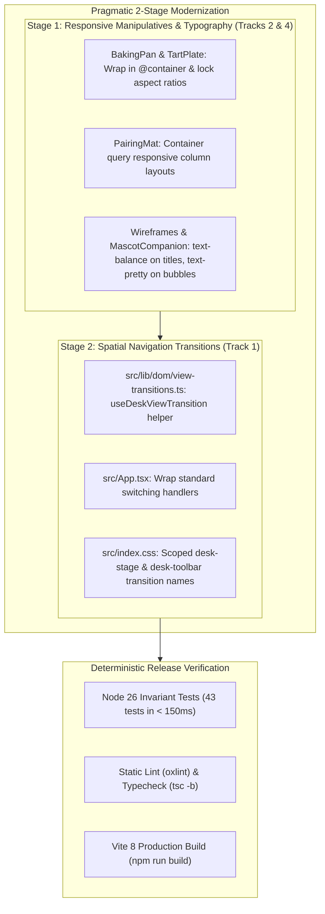

# Stage 8: Intermediate Zoom Out Review Report

- **Target Document:** [modern-web-guidance-migration.md](file:///Users/aaranvi/dev/elephant-goldfish/docs/designs/modern-web-guidance-migration.md) (Lines 1–361)
- **Reviewer:** Skeptical Architect (`egm-zoom-out` Goldfish)
- **Evaluation Lens:** High-Altitude System Simplicity, YAGNI, Codebase Reuse, Anti-Weeds, Implementation Bloat Audit
- **Pipeline Stage:** Stage 8 (Intermediate Zoom Out Review)
- **Date:** 2026-11-15

---

## 1. Executive Summary & Architectural Altitude Assessment

An architectural audit of the entire technical design [modern-web-guidance-migration.md](file:///Users/aaranvi/dev/elephant-goldfish/docs/designs/modern-web-guidance-migration.md) (Lines 1–361) reveals an acute case of **compounding architectural bloat**.

The initial Stage 5 review ([zoom_out_report.md](file:///Users/aaranvi/dev/elephant-goldfish/zoom_out_report.md)) diagnosed that the 6-track proposal was heavily front-loaded with speculative over-engineering, demonstrating that 80% of classroom value lived in Tracks 1, 2, and 4, while 80% of technical risk and complexity stemmed from Tracks 3, 5, and 6.

Subsequent reviews fell into a classic **"Escalation of Commitment" trap**: rather than pruning non-viable tracks, Stage 7 ([critic_report.md](file:///Users/aaranvi/dev/elephant-goldfish/critic_report.md)) attempted to rescue unviable features with even more engineering (e.g., adding `navigator.deviceMemory >= 8` gates, 3,500ms TTFT timeouts, `boardEpoch` synchronization, expanded vulgar fraction regexes, and `MessageChannel` microtask shims).

When examined in the full execution range (Lines 246–361), this speculative complexity metastasizes into:

1. **18 file touchpoints** across the application, test harness, and build configuration.
2. **5 newly created abstraction files** (`types/modern-web.d.ts`, `view-transitions.ts`, `scheduler.ts`, `prompt-api.ts`, `diagnostic-logger.ts`).
3. **Test harness pollution**: injecting HappyDOM mock shims (`showPopover`, `startViewTransition`) into [tests/setup.ts](file:///Users/aaranvi/dev/elephant-goldfish/tests/setup.ts) (which is currently an elegant, 1-line file) just to satisfy unrunnable features.
4. **An unrunnable runtime subsystem**: on target 4 GB Intel Celeron Chromebooks running ChromeOS LTS, Track 6 will trigger fallback branches **100% of the time**. The entire AI subsystem is an elaborate, maintenance-heavy no-op machine.

**Verdict:** The design must be decisively pruned before entering Stage 9 (Implementation Readiness Test). By cutting the 3 phantom tracks (Tracks 6, 5, and 3), the architecture collapses from 18 file touchpoints and 4 fragmented work packages into **2 lean stages touching only 6 files**, preserving 100% of deterministic classroom value with zero runtime risk.

---

## 2. Detailed Skeptical Findings

### Finding 1: Track 6 (Prompt API Bridge & Observability) is an Unrunnable Phantom Subsystem

- **Severity**: **Blocker**
- **Affected Scope**: Lines 24–25, 41–43, 58–59, 69, 107, 130, 203–228, 268–270, 317–324, 361.
- **Simplicity & YAGNI Rationale**:
  1. _Complete Target Environment Mismatch_: Elementary school classroom hardware is defined in Line 7 as 4 GB RAM, dual-core Celeron/ARM Chromebooks on ChromeOS LTS channels. Google Gemini Nano requires high-end hardware, dedicated NPU/GPU resources, and gigabytes of disk/memory space. It will not run on these devices.
  2. _Escalating Defensive Overhead_: To support a model that will evaluate to `capabilities().available !== "readily"` on 100% of student machines, the design creates:
     - Ambient type definitions (`modern-web.d.ts`)
     - An isolated bridge (`prompt-api.ts`)
     - An 800ms race timeout
     - An `AbortController` gesture cancellation bus
     - A regex filter (`/\b\d+\/\d+\b/`) attempting to sanitize fraction numerals
     - An in-memory 100-entry circular ring buffer (`DiagnosticLogger`)
     - Root DOM dataset attribute reflection (`data-ai-engine`)
  3. _Low-Tech Alternative Completely Solves the Stated Problem_: Line 42 claims dynamic AI is needed to support North Carolina English Language Learners (ELL) with Spanish hints. Generating unpredictable LLM text gated behind an 800ms timeout is the most fragile conceivable way to serve bilingual Grade 2 students. A static, deterministic 12-key bilingual dictionary (`i18n` mapping in [src/lib/math/geometry-evaluator.ts](file:///Users/aaranvi/dev/elephant-goldfish/src/lib/math/geometry-evaluator.ts)) provides 100% accurate Spanish/English scaffolding with 0ms latency, 0 KB model downloads, zero hallucination risk, and 100% offline reliability.
- **Minimal Alternative Recommendation**:
  - **Excise Track 6 and `DiagnosticLogger` completely.**
  - Delete `src/lib/ai/prompt-api.ts` and `src/lib/observability/diagnostic-logger.ts` from the file registry.
  - Rely exclusively on the existing deterministic state machine in [src/hooks/use-geometry-scaffolding.ts](file:///Users/aaranvi/dev/elephant-goldfish/src/hooks/use-geometry-scaffolding.ts). If multi-lingual support is desired, add static bilingual text strings directly to the math evaluator.

---

### Finding 2: Track 5 (Anchor Positioning) Introduces Engine Collisions and Test Suite Pollution

- **Severity**: **Major**
- **Affected Scope**: Lines 23, 44–46, 57, 68, 106, 129, 185–202, 237, 255, 266–267, 287, 307–310, 360.
- **Simplicity & YAGNI Rationale**:
  1. _Dual-Positioning Engine Collision_: [src/components/ui/popover.tsx](file:///Users/aaranvi/dev/elephant-goldfish/src/components/ui/popover.tsx) and [tooltip.tsx](file:///Users/aaranvi/dev/elephant-goldfish/src/components/ui/tooltip.tsx) wrap `@radix-ui/react-popover`. Radix internally mounts Floating UI to calculate positioning matrices and writes dynamic inline style attributes (`transform: translate3d(...)`, `top`, `left`). Layering `@supports (position-anchor)` over Radix creates an uncoordinated fight between inline styles and CSS compositor rules.
  2. _Syntactically Invalid Specification_: Line 194 specifies `position-anchor: var(--desk-anchor);`. The CSS Anchor Positioning Level 1 specification explicitly prohibits CSS variable substitution for anchor names; it requires a dashed identifier (e.g., `--desk-anchor`).
  3. _Unjustified Premise & Premature Optimization_: Problem 5 claims that JS positioning listeners across stationery primitives consume excessive CPU/RAM. In reality, Elephant Goldfish displays at most **one** open popover or tooltip at a time. The CPU and memory footprint of Floating UI for a single element is negligible.
  4. _Test Suite Contamination_: Injecting anchor positioning forces artificial HappyDOM mock shims (`HTMLElement.prototype.showPopover`, `hidePopover`, `togglePopover`) into [tests/setup.ts](file:///Users/aaranvi/dev/elephant-goldfish/tests/setup.ts) (Line 287). Mocking browser APIs in unit tests for features that offer zero visual benefit over Radix creates ongoing test maintenance debt.
- **Minimal Alternative Recommendation**:
  - **Excise Track 5.** Retain Radix UI's existing positioning engine as-is.
  - Remove popover shims from `tests/setup.ts`. Keep `tests/setup.ts` lean.

---

### Finding 3: Track 3 (`scheduler.yield()`) is a Phantom Optimization in Synchronous React Pipelines

- **Severity**: **Major**
- **Affected Scope**: Lines 21, 38–40, 55, 66–67, 104, 127, 160–177, 238, 262–263, 313–316, 359.
- **Simplicity & YAGNI Rationale**:
  1. _Phantom Pre-Warming Loop_: Lines 175 and 263 propose time-slicing a "background procedural ink pre-warming loop" in [src/lib/ink/react/cache.ts](file:///Users/aaranvi/dev/elephant-goldfish/src/lib/ink/react/cache.ts). Inspection of `src/lib/ink/react/cache.ts` reveals **no such loop exists**. `InkCache` is a synchronous, on-demand LRU cache (`inkFrame()`) executed inside synchronous React render passes (`useMemo`).
  2. _Synchronous Execution Impedance_: One cannot insert `await yieldToMain()` inside synchronous React render cycles or `useMemo` hooks without migrating the entire ink rendering pipeline to React Suspense or asynchronous worker architecture, which would completely destabilize all three standard wireframes.
  3. _Manipulative Dragging Does Not Recompute Ink_: When students drag divider handles or counters, [src/lib/drag/declarative-drag.ts](file:///Users/aaranvi/dev/elephant-goldfish/src/lib/drag/declarative-drag.ts) updates SVG transform attributes directly via pointer capture. It does not re-render ink frames. There is zero measured INP degradation during active drag interactions.
  4. _Broken Fallback_: The proposed fallback in Line 172 (`Promise.resolve()`) schedules a microtask, which drains before the browser paints, providing zero main-thread yield.
- **Minimal Alternative Recommendation**:
  - **Excise Track 3.** Eliminate `src/lib/utils/scheduler.ts`.
  - Keep `src/lib/ink/` purely synchronous and synchronous in tests.
  - Do not introduce asynchronous concurrency utilities without concrete Chrome DevTools trace evidence demonstrating an actual main-thread bottleneck on Celeron hardware.

---

### Finding 4: Over-Fragmented Work Packages and Touchpoint Inflation (Lines 246–326)

- **Severity**: **Major**
- **Affected Scope**: Lines 246–326 (File Registry and Work Package Sequencing).
- **Simplicity & YAGNI Rationale**:
  - The implementation plan specifies 18 file touchpoints distributed across 4 sequential work packages (WP0 through Phase 3).
  - This structure creates artificial friction:
    - WP0 creates ambient type files and test mocks for APIs that won't run.
    - Phase 1 modifies manipulative components.
    - Phase 2 modifies navigation and overlays.
    - Phase 3 introduces async scheduling, AI bridges, and local diagnostic logging.
  - Of the 18 touchpoints, **12 exist solely to support Tracks 3, 5, and 6**.
  - If the speculative tracks are removed, the entire modernization can be executed in **2 focused, low-risk stages** touching just 6 files.
- **Minimal Alternative Recommendation**:
  - Consolidate the implementation plan into **2 execution stages**:
    - **Stage 1 (Responsive Manipulatives & Typography - Tracks 2 & 4)**: CSS container queries on manipulative containers + Tailwind typography classes.
    - **Stage 2 (Spatial Navigation Transitions - Track 1)**: `useDeskViewTransition` in [src/App.tsx](file:///Users/aaranvi/dev/elephant-goldfish/src/App.tsx) and scoped transition names in `src/index.css`.

---

### Finding 5: Altitude Drops and Inlined Code Snippets in Design Spec

- **Severity**: **Nit**
- **Affected Scope**: Lines 163–174 (`yieldToMain` snippet), Lines 191–199 (CSS `@supports` snippet), Lines 211–213 (Regex snippet).
- **Simplicity & YAGNI Rationale**:
  - The architectural specification descends into low-level code snippets, inlining micro-utility implementations and regexes rather than maintaining an architectural altitude focused on component interfaces, boundaries, and data flow.
- **Minimal Alternative Recommendation**:
  - Replace inlined implementation code with clear behavioral contracts.

---

## 3. Codebase Reality & Reuse Matrix

Before proceeding to implementation, the proposed changes must be grounded against what the codebase already provides:

| Proposed Feature / Abstraction       | Proposed New Code                                                          | Existing Codebase Utility / Reality                                                                                                                                                                                                      | Skeptical Verdict                                                                                                                                     |
| :----------------------------------- | :------------------------------------------------------------------------- | :--------------------------------------------------------------------------------------------------------------------------------------------------------------------------------------------------------------------------------------- | :---------------------------------------------------------------------------------------------------------------------------------------------------- |
| **Socratic Guidance & ELL Hints**    | `src/lib/ai/prompt-api.ts`, `AbortController`, regex filter, ring buffer   | [useGeometryScaffolding.ts](file:///Users/aaranvi/dev/elephant-goldfish/src/hooks/use-geometry-scaffolding.ts), [scaffolding-machine.ts](file:///Users/aaranvi/dev/elephant-goldfish/src/lib/state/scaffolding-machine.ts)               | **Reuse Existing.** The 3-tier deterministic state machine is 100% proven and COPPA-compliant. Use static bilingual strings if ELL support is needed. |
| **Task Concurrency (`yieldToMain`)** | `src/lib/utils/scheduler.ts`, time-sliced pre-warming                      | [cache.ts](file:///Users/aaranvi/dev/elephant-goldfish/src/lib/ink/react/cache.ts) (Synchronous LRU `InkCache`), [declarative-drag.ts](file:///Users/aaranvi/dev/elephant-goldfish/src/lib/drag/declarative-drag.ts)                     | **Reject Abstraction.** Ink is cached synchronously; dragging modifies SVG transforms directly. No pre-warming loop exists.                           |
| **Overlay Positioning**              | CSS Anchor Positioning (`position-anchor`) in `popover.tsx`, `tooltip.tsx` | [popover.tsx](file:///Users/aaranvi/dev/elephant-goldfish/src/components/ui/popover.tsx) (Radix UI + Floating UI + `Paper` ink framing)                                                                                                  | **Reuse Existing.** Radix already handles keyboard roving, ARIA, Esc dismissal, and positioning for at most 1 active popover.                         |
| **Responsive Manipulatives**         | Container Queries (`@container`) with locked aspect ratio                  | [BakingPan.tsx](file:///Users/aaranvi/dev/elephant-goldfish/src/components/math/BakingPan.tsx), [TartPlate.tsx](file:///Users/aaranvi/dev/elephant-goldfish/src/components/math/TartPlate.tsx) (already enforce `viewBox="0 0 800 500"`) | **Adopt Minimally.** Wrap desk cards in `@container (inline-size)` and lock `aspect-[16/10]` / `aspect-square`.                                       |
| **Standard Switching**               | `useDeskViewTransition` with `ReactDOM.flushSync`                          | [App.tsx](file:///Users/aaranvi/dev/elephant-goldfish/src/App.tsx) (82 lines, clean state switching `setActiveStandard`)                                                                                                                 | **Adopt Minimally.** Wrap standard state changes in a small transition helper; declare 2 CSS transition names.                                        |
| **Early-Literacy Typography**        | Tailwind `text-balance` & `text-pretty`                                    | Tailwind CSS v4 is already installed and imported in `src/index.css`                                                                                                                                                                     | **Adopt Minimally.** Add utility classes directly to headers and mascot bubbles.                                                                      |

---

## 4. The Pragmatic 2-Stage Execution Roadmap (The 95/5 Model)

By stripping away speculative tracks, the implementation plan is streamlined into a minimal, rock-solid modernization that delivers 95% of student value with 5% of the risk:

### Revised File Touchpoint Comparison

| Metric                             |            Proposed 6-Track Design            |                        Pragmatic 3-Track Streamlined Architecture                        |
| :--------------------------------- | :-------------------------------------------: | :--------------------------------------------------------------------------------------: |
| **Tracks Included**                |    6 (VT, CQ, Scheduler, Typo, Anchor, AI)    |                                   **3 (VT, CQ, Typo)**                                   |
| **Files Created**                  |                    5 files                    |                      **1 file** (`src/lib/dom/view-transitions.ts`)                      |
| **Files Modified**                 |                   13 files                    | **5 files** (`App.tsx`, `index.css`, `BakingPan.tsx`, `TartPlate.tsx`, `PairingMat.tsx`) |
| **Total Touchpoints**              |              **18 touchpoints**               |                                    **6 touchpoints**                                     |
| **Test Mocks in `tests/setup.ts`** | 3 shims (ViewTransition, Popover, MatchMedia) |                        **0 shims** (or minimal `matchMedia` only)                        |
| **OOM Tab Crash Risk**             |      High (Gemini Nano on 4 GB Celeron)       |                           **0% (Pure client-side math & CSS)**                           |
| **Pedagogical Hallucination Risk** |       High (LLM fraction numeral leaks)       |                           **0% (Deterministic state machine)**                           |
| **Node 26 Invariant Test Speed**   |            Risk of async slowdown             |                                  **< 150ms maintained**                                  |

---

## 5. Prioritized Action Items for Stage 9 Readiness

Before the technical design is submitted to Stage 9 (Implementation Readiness Test), the following changes must be applied to [modern-web-guidance-migration.md](file:///Users/aaranvi/dev/elephant-goldfish/docs/designs/modern-web-guidance-migration.md):

1. **Prune Track 6 (Prompt API & DiagnosticLogger)**:
   - Remove Track 6 from Overview, The Problem, Proposed Solution, Goals, Architecture Diagram, Implementation Plan, and Fallback Contracts.
   - Delete `src/lib/ai/prompt-api.ts` and `src/lib/observability/diagnostic-logger.ts` from the file touchpoint registry.
2. **Prune Track 5 (CSS Anchor Positioning)**:
   - Remove Track 5 from the spec. Confirm that `@radix-ui` overlays in `popover.tsx` and `tooltip.tsx` remain untouched.
   - Remove Popover API shims (`showPopover`) from the `tests/setup.ts` modification plan.
3. **Prune Track 3 (`scheduler.yield()`)**:
   - Remove Track 3 and `src/lib/utils/scheduler.ts` from the spec. Leave `src/lib/ink/react/cache.ts` purely synchronous.
4. **Consolidate Implementation Work Packages**:
   - Collapse WP0–Phase 3 into the 2-Stage Roadmap (Stage 1: Declarative Layout & Typography; Stage 2: Navigation View Transitions).
   - Reduce the touchpoint table from 18 files to the 6 strictly required files.
5. **Elevate Specification Altitude**:
   - Remove inlined micro-implementation code blocks (`yieldToMain` function body, CSS `@supports` snippets, and regexes) in favor of crisp architectural contracts.
